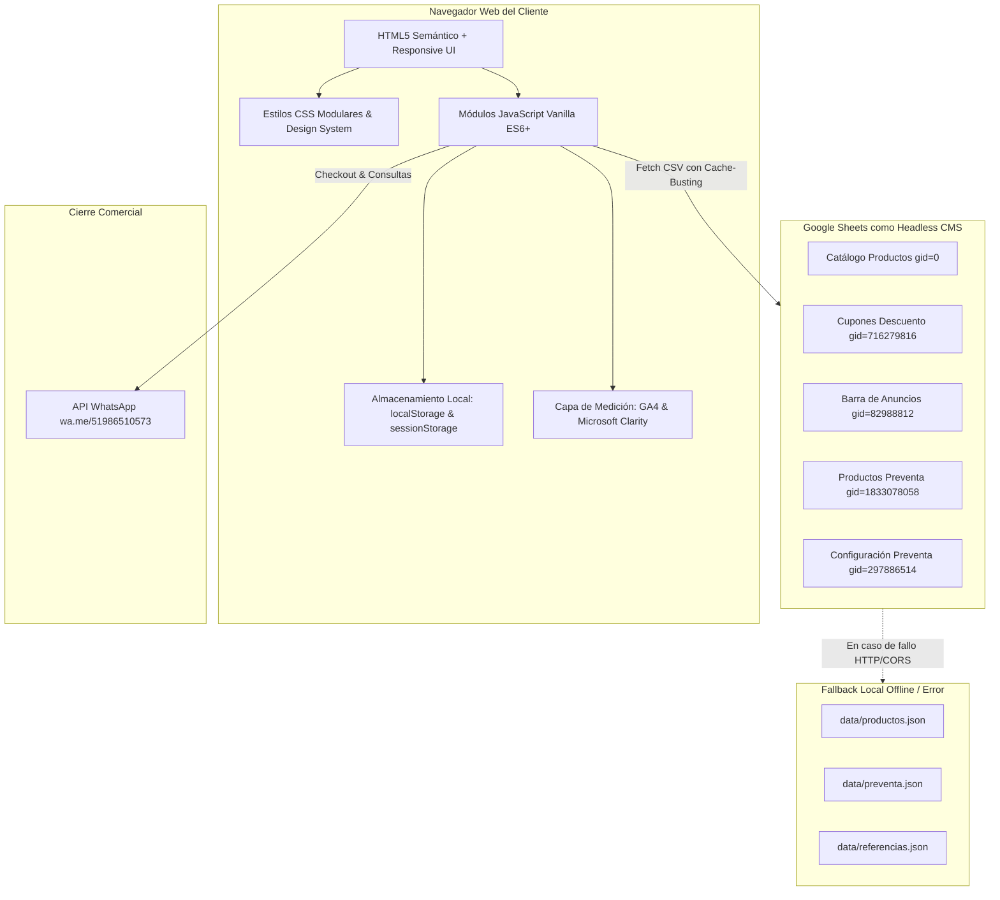

# 00-RESUMEN-MAESTRO.md
# AUDITORÍA INTEGRAL Y TRANSFERENCIA TÉCNICA: DUNES PARFUMS
**Catálogo Digital Web Oficial — Alta Perfumería & Decants**

---

## 1. Identidad y Contexto Comercial del Negocio

| Atributo | Detalle |
| :--- | :--- |
| **Nombre Comercial** | Dunes Parfums |
| **Giro de Negocio** | Tienda boutique especializada en alta perfumería árabe, perfumes de diseñador, perfumería de autor/nicho y decants fraccionados (3 ml, 5 ml y 10 ml). |
| **Ubicación Base** | Jr. Independencia 434, Cacatachi, San Martín, Perú (Coordenadas: `-6.4626252, -76.4491609`). |
| **Canales de Atención** | Canal web estático con finalización y cierre comercial por WhatsApp oficial (`+51 986510573`). |
| **Modelo Transaccional** | Catálogo digital con checkout guiado y carrito interactivo. No cuenta con pasarela de pago bancaria automática integrada (Stripe/Culqi/Niubiz); todo pedido o reserva genera un enlace parametrizado de WhatsApp estructurado profesionalmente (sin emojis ni caracteres corruptos) para confirmación y cobro manual por un asesor comercial. |
| **Dominio y Producción** | `https://dunesparfums.com/` alojado en GitHub Pages con soporte de CNAME y SSL gestionado. |

---

## 2. Visión General de la Arquitectura

El proyecto está concebido bajo una arquitectura **JAMstack Estática Pura (JavaScript Vanilla, APIs ligeras / Headless CMS vía Google Sheets, Markup HTML5 semántico y CSS3 nativo)**.

---

## 3. Stack Tecnológico Verificado

1. **Estructura (HTML5)**:
   - 10 vistas HTML completamente funcionales con semántica estándar (`<header>`, `<nav>`, `<main>`, `<section>`, `<article>`, `<aside>`, `<footer>`, `<dialog>` / modales ARIA).
   - Metadatos SEO completos (Open Graph, Twitter Cards, Canonical tag hacia dominio oficial, JSON-LD Schema.org `LocalBusiness`, `WebSite` y `Product`).
   - Política estricta de indexación: Páginas comerciales indexables (`index.html`, `catalogo.html`, `ayuda.html`), páginas transaccionales/privadas con `noindex, follow` o `noindex, nofollow` (`carrito.html`, `favoritos.html`, `comparador.html`, `preventa/index.html`, `preventa/reserva/index.html`, `404.html`).

2. **Estilos (CSS3 Avanzado & Vanilla Design System)**:
   - Arquitectura de tokens y variables en `:root` (`css/design-system.css`).
   - Hojas modulares especializadas: `css/estilos.css` (171 KB), `css/responsive.css` (184 KB), `css/animaciones.css`, `css/ayuda.css`, `css/preventa.css`, `css/preventa-reserva.css`.
   - Cero frameworks CSS pesados (sin Tailwind, sin Bootstrap). Control absoluto de selectores, diseño Mobile First y adaptación fluida mediante `clamp()`.

3. **Lógica de Negocio (JavaScript ES6+ Vanilla)**:
   - 21 archivos en `js/` organizados por responsabilidades funcionales aisladas (Servicios de datos, Motores de cálculo, Controladores UI, Adaptadores WhatsApp y Analytics).
   - Sin dependencias de bundlers ni transpiladores (Webpack, Vite, Rollup no son necesarios para correr la aplicación).
   - Carga diferida (`defer`) y control estricto de orden de inyección en el DOM.

4. **Persistencia y Datos**:
   - Headless CMS en Google Sheets público publicado como CSV.
   - Parseador CSV propio en JS capaz de manejar comillas dobles escapadas (`""`), saltos de línea CRLF/LF, comas dentro de textos y normalización de caracteres Unicode con BOM (`\uFEFF`).
   - 7 almacenes de persistencia en navegador (detallados en sección de datos).

5. **Infraestructura de Pruebas (Test Suite)**:
   - Suite de pruebas unitarias e integración basada en el ejecutor nativo de Node.js (`node --test tests/*.test.js`).
   - **373 pruebas automatizadas pasando con éxito (0 fallos, 0 omitidas)** al momento de esta auditoría.

---

## 4. Mapa General de Páginas y Enrutamiento

| Archivo | Ruta Web | Propósito Comercial | Dependencias JS Principales |
| :--- | :--- | :--- | :--- |
| `index.html` | `/` | Portada principal: Hero, Banner anuncios, Categorías, Productos Destacados, Oferta Especial rotativa, Beneficios de compra, Reseñas y Ubicación. | `config.js`, `productos-service.js`, `anuncios-service.js`, `anuncios-ui.js`, `favoritos-service.js`, `whatsapp.js`, `productos.js`, `carrito.js`, `interfaz.js` |
| `catalogo.html` | `/catalogo.html` | Catálogo completo: Filtros por formato (Sellado/Decant), tipo (Árabe, Diseñador, Nicho), género (Hombre, Mujer, Unisex), ocasión de uso (Citas, Noche, Diario, Versátil, Formal), buscador instantáneo, ordenamiento por precio y relevancia, botón cotizar WhatsApp cuando no hay stock. | Añade `catalogo.js` |
| `producto.html` | `/producto.html?id={id}` | Detalle individual de fragancia: Galería con lightbox zoom, selector de presentaciones (frascos completos vs decants de 3ml, 5ml, 10ml), contador de stock/ml, productos relacionados mediante algoritmo Fisher-Yates, barra móvil fija de compra. | `productos-service.js`, `productos.js`, `carrito.js`, `interfaz.js` |
| `carrito.html` | `/carrito.html` | Carrito de compras y Checkout Progresivo: Tabla de ítems con validación de stock unitario y ml, motor de cupones de descuento con verificación en vivo, modalidades de entrega (Delivery Local por zonas, Envío por Agencia, Recojo Local), cálculo automático de fletes y apertura de WhatsApp con pedido estructurado. | Añade `cupones-service.js`, `cupones.js`, `cupones-ui.js` |
| `favoritos.html` | `/favoritos.html` | Lista de deseos (Wishlist): Lectura reactiva de `dunes_favoritos`, renderizado de tarjetas, agregar al carrito directo y sincronización multi-pestaña. | Añade `favoritos-page.js` |
| `comparador.html` | `/comparador.html` | Comparador olfativo interactivo cara a cara: Modo Sellados y Modo Decants, búsqueda independiente en 2 columnas, despliegue de fichas olfativas (`imagen_notas`), selector de cantidad y compra directa. | Añade `comparador.js` |
| `ayuda.html` | `/ayuda.html` | Centro de confianza y soporte: Acordeón interactivo de Preguntas Frecuentes con buscador dinámico, carrusel de referencias y modal de galería completa de entregas, envíos y decants reales con Lightbox. | Añade `ayuda.js` |
| `preventa/index.html`| `/preventa/` | Landing de Preventa Exclusiva: Fragancias por llegar con fecha estimada libre, reserva con adelanto congelado de S/ 10.00 por unidad, filtros dedicados y modal explicativo inicial. | `preventa-service.js`, `preventa.js`, `preventa-cart.js` |
| `preventa/reserva/index.html` | `/preventa/reserva/` | Checkout exclusivo de Preventa: Resumen de fragancias reservadas, cálculo de adelanto total requerido y saldo pendiente por pagar al recibir, validación de stock y confirmación por WhatsApp. | `preventa-service.js`, `preventa-cart.js`, `preventa-reserva.js` |
| `404.html` | `/404.html` | Página de error 404 personalizada con enlace de retorno al catálogo e inicio. | No requiere JS activo |

---

## 5. Estado General del Sistema

| Módulo / Sistema | Estado Verificado | Notas Técnicas |
| :--- | :--- | :--- |
| **Carga de Productos (Google Sheets + JSON)** | **Completo & Robusto** | Soporta URLs con `no-store` y timestamp anti-caché. Fallback transparente y pruebas unitarias passing. |
| **Catálogo y Filtrado Multinivel** | **Completo** | Preserva estado y posición de scroll (`scrollY`) en `sessionStorage` hasta por 2 horas. |
| **Variantes de Decants (3, 5, 10 ml)** | **Completo** | Control estricto de mililitros compartidos en carrito para evitar sobreventa de un mismo frasco madre. |
| **Motor de Cupones de Descuento** | **Completo** | Soporta porcentaje, monto fijo, compra mínima, límite máximo, fechas de vigencia y alcance por producto/categoría. |
| **Barra Superior de Anuncios** | **Completo** | Se oculta automáticamente si no hay anuncios activos en Google Sheets o si ocurre un error HTTP. |
| **Comparador Olfativo** | **Completo** | Garantiza dropdown único abierto y exclusión del producto opuesto. |
| **Módulo Independiente de Preventa** | **Completo** | Arquitectura 100% aislada de `dunes_cart`, storage propio `dunes_preventa_cart`, adelanto de S/10. |
| **Checkout y WhatsApp** | **Completo** | Validaciones progresivas por pasos con scroll automático a errores. Mensajes de WhatsApp limpios sin emojis. |
| **Analítica y Medición** | **Completo** | Implementación defensiva de GA4 y Clarity con filtrado estricto de PII (datos personales del cliente bloqueados). |
| **Diseño Responsive & Accesibilidad** | **Completo** | Menú drawer lateral móvil con control `inert`, `aria-hidden` y trampeo de foco. |

---

## 6. Método de Ejecución Local

Dado que la aplicación realiza solicitudes `fetch()` hacia `data/productos.json`, `data/preventa.json` y endpoints de Google Sheets:

1. **Vía Servidor Web Local (Recomendado)**:
   - Al estar en un entorno XAMPP (`c:\xampp\htdocs\DUNES-PARFUMS-CATALOGO`), iniciar el módulo Apache de XAMPP.
   - Navegar en el navegador a: `http://localhost/DUNES-PARFUMS-CATALOGO/`
2. **Vía VS Code Live Server / Node HTTP**:
   - Abrir la carpeta en VS Code y activar la extensión "Live Server" en el puerto asignado (ej. `http://127.0.0.1:5500/`).
   - O ejecutar: `npx serve .`
3. **Ejecución de Pruebas Automatizadas**:
   - Ejecutar en consola: `npm test`
   - El comando ejecuta `node --test tests/*.test.js` y valida los 373 casos de prueba del proyecto.
