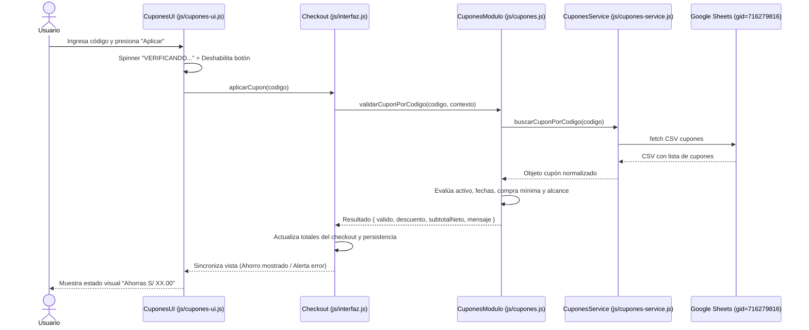

# 03-MODULOS-Y-FUNCIONALIDADES.md
# ANÁLISIS FUNCIONAL PROFUNDO DE TODOS LOS MÓDULOS

En este documento se desglosan todos los módulos identificados en el código de Dunes Parfums bajo el esquema estandarizado de auditoría técnica.

---

## 1. Módulo: Servicio de Datos y Carga del Catálogo (`ProductosService`)

### A. Propósito
Centralizar la obtención, sanitización, parseo y estructuración de la base de datos de perfumes desde Google Sheets en formato CSV, proveyendo un mecanismo de respaldo automático hacia `data/productos.json` si la hoja de cálculo no responde, devuelve HTML o presenta errores de red.

### B. Funcionamiento
1. Verifica si ya existe una promesa de carga activa en curso (`single-flight request sharing`) para evitar solicitudes simultáneas duplicadas al cargar varios scripts en paralelo.
2. Añade un timestamp dinámico a la URL de Google Sheets (`&v=timestamp`) con encabezado `{ cache: "no-store" }` para saltarse la caché HTTP de navegadores y proxies.
3. El parser CSV nativo (`parseCSV`) recorre carácter por carácter identificando celdas entre comillas, comillas dobles escapadas (`""`), saltos de línea CRLF/LF y delimitadores por coma.
4. Normaliza cabeceras: elimina caracteres BOM (`\uFEFF`), convierte a minúsculas y reemplaza espacios por guiones bajos.
5. Valida campos mínimos obligatorios: `id`, `nombre`, `marca`, `categoria`, `formato`, `imagen`, `visible`. Si una fila no cumple, la descarta registrando un aviso en consola sin interrumpir la carga.
6. Separa productos en dos grandes familias: **Sellados** (stock en unidades físicas, precio base) y **Decants** (mililitros disponibles, parseo de precios individuales para 3ml, 5ml y 10ml).
7. Si el `fetch` falla o el CSV es inválido, activa de forma transparente el método `cargarDesdeRespaldo()`, leyendo `data/productos.json`.
8. Almacena el resultado en la caché en memoria `_cacheRespuestaProductos` para el ciclo de vida de la página.

### C. Interfaz
No posee UI directa. Expone métodos globales accesibles por la interfaz y otros scripts: `window.ProductosService.cargarProductos()`, `window.resolverImagen()`, `window.ProductosService.limpiarCacheMemoria()`.

### D. Arquitectura
- **Archivo**: `js/productos-service.js` (500 líneas).
- **Patrón**: Módulo IIFE (Immediately Invoked Function Expression) exponiendo una API pública (`serviceObj`) ligada a `window` y `global`.
- **Funciones clave**: `parseCSV()`, `limpiarValorImportado()`, `normalizarCabecera()`, `normalizarNumero()`, `normalizarBooleano()`, `normalizarGenero()`, `resolverImagen()`, `cargarDesdeRespaldo()`, `_ejecutarCargaProductosInterna()`, `cargarProductos()`.

### E. Comunicación
Es la **fuente primaria de datos** para:
- `js/productos.js` (que consume `ProductosService.cargarProductos()`).
- `js/catalogo.js` (para renderizar la grilla y filtros).
- `js/carrito.js` (para validar stock en tiempo real al agregar o modificar cantidades).
- `js/comparador.js` (para obtener fragancias elegibles con notas olfativas).
- `js/favoritos-page.js` (para enriquecer los IDs guardados con sus datos reales).

### F. Datos
- **Entrada Primaria**: Google Sheets CSV (`CONFIG.GOOGLE_SHEETS_CSV_URL` en `js/config.js`, gid=0).
- **Entrada de Respaldo**: `data/productos.json` (o copia local `data/productos-google-sheets.csv`).
- **Salida**: Objeto `{ productos: Array<Producto>, origen: "google-sheets" | "json-respaldo" }`.

### G. Reglas de Negocio
- Toda fragancia con `visible: false` o `visible: 0` es descartada del catálogo comercial.
- En perfumes sellados: `precio > 0`, `stock >= 0` y `presentacion` no vacía.
- En decants: debe existir al menos un precio positivo en las columnas `precio_3ml`, `precio_5ml` o `precio_10ml`. Si el precio base no está definido, calcula automáticamente el precio menor entre las presentaciones válidas (ej. S/ 15).
- Soporta formatos de número con coma decimal ("180,00") o punto ("180.00") y limpia símbolos de moneda ("S/", "$").

### H. Estado
**Completo y en producción**. 100% verificado por pruebas unitarias en `tests/productos-service.test.js`.

### I. Riesgos
- Si se modifica la estructura de columnas en Google Sheets eliminando encabezados obligatorios, el parser activará el fallback a `data/productos.json`. El respaldo local debe mantenerse sincronizado periódicamente mediante las herramientas en `tools/`.

---

## 2. Módulo: Carrito de Compras y Control de Stock por Variantes (`carritoModulo`)

### A. Propósito
Gestionar las operaciones del carrito de compra, garantizando que nunca se vendan unidades por encima del inventario físico (en frascos sellados) ni mililitros por encima del contenido disponible del frasco madre (en decants), independientemente de cómo el cliente combine las presentaciones de 3ml, 5ml y 10ml.

### B. Funcionamiento
1. **Identificador Compuesto en Carrito**:
   - Sellados: `id = idProducto` (ej. `"p1"`).
   - Decants: `id = idProducto-tamanoMl` (ej. `"d1-3"`, `"d1-5"`, `"d1-10"`).
2. **Algoritmo de Stock de Decants Compartido**:
   - Cuando un usuario intenta agregar o incrementar un decant de $T$ ml (donde $T \in \{3, 5, 10\}$):
   - Se consulta el producto original en el catálogo (`mililitrosDisponibles`).
   - Se suman todos los mililitros consumidos en el carrito por **otras presentaciones** de esa misma fragancia:
     $$\text{mlOtros} = \sum (\text{tamanoMl}_i \times \text{cantidad}_i) \quad \forall i \neq \text{item actual}$$
   - Se calculan los mililitros restantes disponibles exclusivamente para esta presentación:
     $$\text{mlDisponiblesParaItem} = \text{mililitrosDisponibles} - \text{mlOtros}$$
   - El stock máximo de unidades que se pueden añadir es:
     $$\text{stockMaximo} = \left\lfloor \frac{\text{mlDisponiblesParaItem}}{T} \right\rfloor$$
3. Si el usuario excede el stock, el incremento se bloquea, se ajusta al máximo posible y se muestra una notificación toast informativa (`mostrarToastPremium`).
4. **Prevención de Condiciones de Carrera (`_bloqueosActualizacionCantidad`)**:
   - Utiliza un `Set` en memoria que bloquea temporalmente el procesamiento concurrente de un mismo ítem ante ráfagas de clics rápidos en los botones `+` y `-`.
5. Emite eventos a `Analytics.trackAddToCart` y `Analytics.trackRemoveFromCart`.
6. Si el carrito llega a 0 productos, reinicia automáticamente el cupón de descuento activo llamando a `cuponesCheckout.quitarCupon()`.

### C. Interfaz
- Icono del carrito en cabecera con badge numérico animado (`.cart-count.badge-pop`).
- Micro-animación en el icono de la cabecera al agregar (`.is-cart-animated`).
- Modal de confirmación inmediata (`#cart-added-modal`) con resumen del producto agregado y subtotal.
- Toasts flotantes (`.toast-premium`) para advertencias de stock o confirmaciones.
- Tabla interactiva en `carrito.html` con selectores `+`/`-`, botón eliminar y modal para vaciar pedido completo (`#modal-confirm-vaciar`).

### D. Arquitectura
- **Archivos**: `js/carrito.js` (649 líneas), funciones de checkout en `js/interfaz.js`.
- **Objeto Global**: `window.carritoModulo`.
- **Funciones clave**: `obtenerCarrito()`, `guardarCarrito()`, `actualizarContadorCarrito()`, `agregarAlCarrito()`, `actualizarCantidadItem()`, `eliminarItem()`, `vaciarCarrito()`, `mostrarToastPremium()`, `mostrarModalAgregarCarrito()`, `ocultarModalAgregarCarrito()`.

### E. Comunicación
- Consume productos desde `window.productosModulo.obtenerProductoPorId()`.
- Sincroniza con `cuponesCheckout` en `js/interfaz.js` para recalcular descuentos.
- Dispara eventos a `window.Analytics`.
- Invoca a `window.renderizarCarritoDOM()` si está en `carrito.html`.

### F. Datos
- **Almacenamiento**: `localStorage.getItem('dunes_cart')` / `setItem('dunes_cart', JSON.stringify(carrito))`.
- **Estructura del ítem**:
  ```json
  {
    "id": "d1-5",
    "idProducto": "d1",
    "nombre": "Mandarin Sky (Decant)",
    "marca": "Armaf",
    "imagen": "img/productos/ArmafMandarinSkyDECANTS.webp",
    "tipo": "ARABE",
    "categoria": "decants",
    "presentacion": "Decant 5 ml",
    "tamanoMl": 5,
    "precioUnitario": 20.00,
    "cantidad": 2,
    "subtotal": 40.00
  }
  ```

### G. Reglas de Negocio
- Si un producto tiene `disponible: false`, no puede ser añadido bajo ninguna circunstancia.
- Para sellados con oferta activa (`oferta: true`), el precio unitario toma prioritariamente `precio_oferta`.
- Si la reducción de cantidad llega a 0, se elimina automáticamente el ítem del carrito.

### H. Estado
**Completo y en producción**. Validado exhaustivamente en `tests/carrito-boton-mas-stock.test.js`, `tests/decants-nuevas-reglas.test.js` y `tests/cart-added-modal.test.js`.

### I. Riesgos
- Si el usuario mantiene productos en su `localStorage` durante semanas y el stock en Google Sheets disminuye, la función `actualizarCantidadItem` valida contra el inventario fresco al intentar modificar cantidades, garantizando auto-recuperación.

---

## 3. Módulo: Motor de Cupones de Descuento (`CuponesModulo` & `CuponesService`)

### A. Propósito
Permitir la aplicación de códigos promocionales comerciales (porcentaje o monto fijo) gestionados dinámicamente desde una pestaña dedicada de Google Sheets, con validaciones estrictas de vigencia, monto mínimo y alcance, sin necesidad de desplegar cambios en el código.

### B. Funcionamiento


### C. Interfaz
- Caja `#coupon-section` en `carrito.html`.
- Entrada de texto con conversión automática a mayúsculas (`coupon-code`).
- Botón `#coupon-apply-btn` con estado de carga `VERIFICANDO...` (tiempo mínimo perceptible de 400ms para feedback táctil).
- Mensajes de error claros ("INGRESA UN CUPÓN", "CUPÓN NO VÁLIDO", "El pedido no alcanza la compra mínima de S/ XX.00", "Este cupón no aplica a los productos de tu pedido").
- Estado aplicado `#coupon-applied-state` con código, monto descontado y botón de remover (`#coupon-remove-btn`).

### D. Arquitectura
- **Archivos**:
  - `js/cupones-service.js` (304 líneas): Parseo CSV desde Sheets (`CONFIG_CUPONES`).
  - `js/cupones.js` (313 líneas): Motor matemático puro, desacoplado del DOM.
  - `js/cupones-ui.js` (281 líneas): Control visual, eventos y accesibilidad.
  - Integración en `js/interfaz.js` (`cuponesCheckout`, líneas 2737-2995).
- **Funciones clave**: `validarCupon()`, `calcularDescuento()`, `obtenerSubtotalElegible()`, `redondearMoneda()`, `parsearFechaLocal()`.

### E. Comunicación
- Interactúa con el carrito para leer los ítems actuales.
- Provee a `interfaz.js` el valor `descuento` para restar del subtotal general.
- Al confirmar el pedido, `whatsapp.js` lee el cupón aplicado para incluirlo desglosado en el texto enviado al asesor.

### F. Datos
- **Fuente**: Google Sheets CSV (`CONFIG_CUPONES.sheetsCsvUrl`, gid=716279816).
- **Persistencia en Navegador**: `sessionStorage.getItem('dunes_cupon_aplicado')` guarda el código activo para mantener el descuento si el usuario navega entre páginas durante la misma sesión.

### G. Reglas de Negocio
- Tipos admitidos: `porcentaje` (valor 1 a 100) y `monto_fijo` (valor en soles).
- Un cupón porcentual no puede descontar más de su `descuentoMaximo` si este campo está configurado.
- Un cupón con alcance `categorias` solo calcula el porcentaje sobre el subtotal de productos pertenecientes a las categorías permitidas (`categoriasPermitidas` separadas por `|`).
- Un cupón con alcance `productos` solo aplica sobre los IDs específicos configurados.
- Las fechas de inicio y vencimiento se evalúan en tiempo local evitando desfasajes por zona horaria UTC (`parsearFechaLocal`).

### H. Estado
**Completo y en producción**. Validado en `tests/cupones-motor.test.js`, `tests/cupones-checkout.test.js`, `tests/cupones-storage.test.js` y `tests/whatsapp-cupones.test.js`.

### I. Riesgos
- Como la validación ocurre en el cliente, un usuario técnico podría simular fechas locales o alterar montos en el navegador; sin embargo, **el modelo comercial de Dunes Parfums mitiga esto al 100%**, ya que la venta final se autoriza manualmente por WhatsApp, donde el asesor valida el código del cupón en su hoja de cálculo antes de aceptar el abono.

---

## 4. Módulo: Checkout Progresivo y Zonas de Entrega (`interfaz.js` & `whatsapp.js`)

### A. Propósito
Guiar al cliente en la selección del método de entrega idóneo (Delivery local en San Martín, Envío nacional por agencia o Recojo en tienda), validar sus datos y generar el enlace de WhatsApp oficial con el formato exacto del pedido sin errores de codificación.

### B. Funcionamiento
1. El usuario selecciona una de las 3 modalidades:
   - **Delivery local**: Despliega la cuadrícula de 6 zonas con sus tarifas.
   - **Envío por agencia**: Oculta zonas y campos innecesarios. Muestra costo de embalaje/llevada a agencia (S/ 10.00 o GRATIS si la compra supera S/ 250.00). Informa que los datos de la agencia se coordinan por chat.
   - **Recojo en local**: Costo S/ 0.00. Solo solicita nombre del cliente y muestra la dirección física de la tienda en Cacatachi.
2. Al pulsar "Confirmar pedido por WhatsApp":
   - Ejecuta `validarFormularioEntrega()`.
   - Si falta algún dato, llama a `irAlPrimerPasoIncompleto()` que inyecta una alerta visual y enfoca el campo faltante con scroll suave.
   - Si todo es válido, construye el objeto `pedido` y llama a `enviarPedidoWhatsApp()`.
   - Genera la URL con `encodeURIComponent()` verificando que no existan caracteres corruptos (`%EF%BF%BD`).
   - Dispara el evento `Analytics.trackLead()`.
   - Abre WhatsApp en nueva pestaña (`window.open`) con fallback a redirección directa en móviles si el navegador bloquea ventanas emergentes.

### C. Interfaz
- Tarjetas de modalidad (`.delivery-method-card`).
- Tarjetas de zona (`.delivery-zone-card`).
- Campos de formulario con resaltado contextual y validación en tiempo real.
- Caja de alerta de validación (`.checkout-validation-alert`).
- Botón dorado `#btn-confirmar-whatsapp`.
- Barra inferior sticky `#mobile-checkout-bar` para pantallas pequeñas.

### D. Arquitectura
- **Archivos**: `js/interfaz.js` (sección checkout, líneas 2500-3550), `js/whatsapp.js` (223 líneas).
- **Zonas configuradas (`ZONAS_DELIVERY_LOCAL`)**:
  - `cacatachi`: Costo S/ 0 (Gratis).
  - `morales`: Tarifa plana S/ 5.00 (Gratis desde S/ 150.00).
  - `tarapoto-central`: Tarifa plana S/ 7.00 (Gratis desde S/ 150.00).
  - `tarapoto-aeropuerto`: Tarifa plana S/ 8.00 (Gratis desde S/ 150.00).
  - `banda-entrada`: Tarifa plana S/ 7.00 (Gratis desde S/ 150.00).
  - `banda-alta`: Tarifa plana S/ 8.00 (Gratis desde S/ 200.00).

### E. Comunicación
- Lee el carrito desde `carritoModulo.obtenerCarrito()`.
- Lee el cupón desde `cuponesCheckout.obtenerEstado()`.
- Envía datos a `whatsappConfig.enviarPedidoWhatsApp()`.
- Notifica a `Analytics.trackShippingInfo()` y `Analytics.trackLead()`.

### F. Datos
- Guarda la preferencia en `localStorage.getItem('dunes_entrega_pref')` para recordar si el cliente prefiere delivery o agencia en futuras compras.

### G. Reglas de Negocio
- Mensaje de WhatsApp **100% limpio sin emojis**, estructurado formalmente en bloques: `*PRODUCTOS*`, `*RESUMEN DEL PEDIDO*`, `*DATOS DEL CLIENTE*`.
- En caso de delivery local, incluye el nombre de la zona y la referencia del sector para facilitar la logística del motorizado.

### H. Estado
**Completo y en producción**. Verificado en `tests/progressive-checkout.test.js`, `tests/zone-card-click.test.js`, `tests/delivery-zonas.test.js` y `tests/whatsapp-cupones.test.js`.

---

## 5. Módulo: Preventa Exclusiva y Reservas Anticipadas (`PreventaService` & `PreventaCart`)

### A. Propósito
Gestionar un sistema comercial totalmente independiente para fragancias en tránsito que aún no han llegado a stock físico, permitiendo a los clientes congelar el precio promocional con un adelanto mínimo de **S/ 10.00 por frasco**, coordinando la separación directamente por WhatsApp.

### B. Funcionamiento
1. **Aislamiento Arquitectural Total**:
   - No utiliza `dunes_cart`.
   - Utiliza la clave exclusiva `dunes_preventa_cart`.
   - Los productos del catálogo general y de preventa nunca se mezclan.
2. **Carga desde Google Sheets (gid=1833078058)**:
   - `PreventaService.cargarProductos()` lee la hoja de preventa.
   - Lee fecha estimada libre de llegada (`fecha_llegada`) desde `CONFIG_PREVENTA` (gid=297886514).
3. **Fórmulas Financieras de Preventa**:
   - $\text{Total Compra} = \sum (\text{cantidad}_i \times \text{precio\_preventa}_i)$
   - $\text{Adelanto Requerido} = \sum (\text{cantidad}_i \times 10.00)$
   - $\text{Saldo a Liquidar al Recibir} = \text{Total Compra} - \text{Adelanto Requerido}$
4. **Control de Stock de Preventa**:
   - Cada producto en preventa tiene un stock máximo asignado en la hoja.
   - Si el usuario intenta reservar más unidades del stock disponible, el sistema bloquea la acción y emite el toast `#preventa-stock-toast` con el mensaje oficial: *"Lo sentimos, solo tenemos X unidades disponibles para preventa."*
5. **Confirmación**:
   - En `/preventa/reserva/index.html`, el botón de WhatsApp genera un mensaje exclusivo de preventa detallando unidades, total de compra, adelanto a transferir y saldo restante a abonar contra entrega.

### C. Interfaz
- Landing page dedicada: `/preventa/index.html`.
- Checkout de reserva: `/preventa/reserva/index.html`.
- Modal inicial informativo (FASE P3.2) sin persistencia para asegurar que todo visitante entienda las condiciones.
- Modal de confirmación al reservar (FASE P4.2) con desglose de adelanto y saldo.
- Indicador flotante en cabecera `#reserva-header-count`.

### D. Arquitectura
- **Archivos**:
  - `js/preventa-service.js` (544 líneas): Carga y normalización.
  - `js/preventa.js` (188 líneas): Filtros por ocasión, género, tipo y ordenación.
  - `js/preventa-cart.js` (796 líneas): Motor de reservas y cálculo de saldos.
  - `js/preventa-reserva.js` (644 líneas): Controlador de checkout y WhatsApp preventa.
  - `css/preventa.css` y `css/preventa-reserva.css`.
- **Objetos Globales**: `window.PreventaService`, `window.PreventaCart`, `window.PreventaFilters`.

### E. Comunicación
Totalmente desacoplado del resto de la tienda. Solo comparte los estilos del `design-system.css`, el número de WhatsApp oficial y las utilidades de analítica.

### F. Datos
- **Fuente**: Google Sheets (gid=1833078058 y gid=297886514).
- **Persistencia**: `localStorage.getItem('dunes_preventa_cart')`.

### G. Reglas de Negocio
- La reserva exige exactamente S/ 10.00 por unidad.
- Productos con `disponible: false` o `stock <= 0` se muestran como `PREVENTA CERRADA` y sus botones quedan inhabilitados.
- Las ocasiones de uso se extraen dinámicamente de los productos cargados respetando comas (ej. "Citas,Noche").

### H. Estado
**Completo y en producción**. Validado por 4 archivos de prueba unitaria en `tests/preventa-service.test.js`, `tests/preventa-cart.test.js`, `tests/preventa-reserva.test.js`.

---

## 6. Módulo: Comparador Olfativo por Fichas (`ComparadorModulo`)

### A. Propósito
Facilitar la decisión de compra permitiendo comparar dos fragancias lado a lado mediante sus pirámides olfativas (`imagen_notas`), resolviendo la dificultad del cliente para distinguir aromas en compras por internet.

### B. Funcionamiento
1. El usuario selecciona modo **Sellados** o **Decants**.
2. Cada columna cuenta con un mini-buscador independiente con autocompletado en tiempo real.
3. Al seleccionar una fragancia en la Columna 1:
   - Se muestra la ficha olfativa ampliable con badge "VER FICHA".
   - Se cargan los controles de compra directa.
   - En la Columna 2, esa misma fragancia queda automáticamente excluida de los resultados de búsqueda.
4. Si el usuario toca la ficha olfativa, se abre el visor `Lightbox` en alta definición para inspeccionar las notas de salida, corazón y fondo.
5. El botón "AGREGAR" añade la fragancia directamente al carrito regular llamando a `window.agregarAlCarrito()`.

### C. Interfaz
- `comparador.html`.
- Selector de modo `.comparator-mode-selector`.
- Dos columnas simétricas (`#col-izquierdo`, `#col-derecho`).
- Dropdowns flotantes con miniaturas de producto.
- Selector de cantidad compacto y pills de ml en decants.

### D. Arquitectura
- **Archivo**: `js/comparador.js` (759 líneas).
- **Objeto Global**: `window.ComparadorModulo`.
- **Funciones clave**: `closeComparatorDropdowns()`, `openComparatorSearch()`, `verificarSingleDropdownState()`, `obtenerProductosElegibles()`, `seleccionarModo()`, `seleccionarProducto()`, `crearComponenteBuscador()`, `crearComponenteFicha()`.

### E. Comunicación
- Consume catálogo desde `ProductosService.cargarProductos()`.
- Envía pedidos al carrito mediante `window.agregarAlCarrito()`.
- Abre el lightbox a través de `window.interfaz.abrirLightboxVisor()`.

### F. Datos
- Estado en memoria durante la sesión: `state.modo`, `state.izq`, `state.der`. No requiere persistencia en `localStorage`.

### G. Reglas de Negocio
- Solo fragancias con `imagen_notas` definida pueden participar en la comparación.
- En modo sellados exige `stock > 0`.
- Control estricto de dropdown único: hacer foco en un lado cierra físicamente el lado opuesto.

### H. Estado
**Completo y en producción**. Validado en `tests/comparador.test.js` y `tests/comparador-cierre-buscadores.test.js`.

---

## 7. Módulo: Gestión de Favoritos / Wishlist (`FavoritosService`)

### A. Propósito
Permitir a los usuarios guardar fragancias de su interés haciendo clic en el icono de corazón, manteniendo la lista accesible permanentemente en `favoritos.html` y actualizando los contadores de cabecera en toda la tienda.

### B. Funcionamiento
- Gestiona un array de IDs de producto en `localStorage` bajo la clave `dunes_favoritos`.
- Emite un `CustomEvent` nativo (`dunes:favoritos:updated`) cada vez que se agrega o quita un favorito, actualizando reactivamente los contadores `#favorites-count` en la cabecera.
- Escucha el evento `storage` en `window` para mantener sincronizadas múltiples pestañas abiertas al mismo tiempo.
- En `favoritos.html`, la cuadrícula se actualiza en vivo al desmarcar un corazón sin requerir recargar la página.

### C. Arquitectura
- **Archivos**: `js/favoritos-service.js` (266 líneas), `js/favoritos-page.js` (374 líneas).
- **Objeto Global**: `window.FavoritosService`.
- **Funciones clave**: `obtenerFavoritos()`, `esFavorito()`, `agregarFavorito()`, `quitarFavorito()`, `alternarFavorito()`, `obtenerCantidadFavoritos()`, `limpiarFavoritosInexistentes()`.

### D. Estado
**Completo y en producción**. Validado en `tests/favoritos-service.test.js`, `tests/favoritos-integration.test.js` y `tests/favoritos-add-to-cart.test.js`.

---

## 8. Módulo: Barra Superior de Anuncios (`AnunciosService` & `AnunciosUI`)

### A. Propósito
Mostrar avisos promocionales dinámicos (envíos gratis, ofertas por tiempo limitado, métodos de pago) administrados en Google Sheets en la parte superior de todas las páginas principales.

### B. Funcionamiento
1. Consulta la hoja de anuncios (`CONFIG.GOOGLE_SHEETS_ANUNCIOS_CSV_URL`, gid=82988812).
2. Filtra filas con `activo: true` y ordena según la columna `orden`.
3. **Regla de Ocultamiento Total**: Si no hay anuncios activos, si todos están en `false` o si la hoja no responde, ejecuta `ocultarBarraSuperior()`, que oculta el nodo `#announcement-bar` agregando `hidden` y `aria-hidden="true"`, deteniendo cualquier temporizador.
4. Si hay 2 o más anuncios activos, inicia una rotación automática cada 4000 ms (`iniciarRotacion`) con animación suave de desvanecimiento (`fade-out` / `fade-in`).

### C. Arquitectura
- **Archivos**: `js/anuncios-service.js` (210 líneas), `js/anuncios-ui.js` (211 líneas).
- **Objetos Globales**: `window.AnunciosService`, `window.AnunciosUI`.

### D. Estado
**Completo y en producción**. Validado en `tests/anuncios.test.js`.

---

## 9. Módulo: Capa Central de Analítica (`Analytics`)

### A. Propósito
Proveer una interfaz única, segura y resistente a fallos para enviar eventos de comportamiento y comercio electrónico a Google Analytics 4 (GA4) y Microsoft Clarity, bloqueando estrictamente la fuga de datos personales (PII).

### B. Funcionamiento
- Sanitización estricta (`sanitizePayload`): Filtra y elimina automáticamente cualquier propiedad sensible antes de transmitir (`nombre`, `telefono`, `direccion`, `referencia`, `email`, etc.).
- Eventos e-commerce estándar implementados:
  - `add_to_cart`: Al agregar producto desde cualquier tarjeta, detalle o comparador.
  - `remove_from_cart`: Al eliminar un ítem en el carrito.
  - `view_cart`: Al abrir la página del carrito.
  - `begin_checkout`: Al interactuar con los pasos de entrega.
  - `add_shipping_info`: Al seleccionar modalidad o zona de delivery.
  - `coupon_applied`: Al validar exitosamente un cupón.
  - `catalog_search`: Al realizar búsquedas en el catálogo.
  - `generate_lead` / `whatsapp_lead`: Al pulsar el botón de confirmación hacia WhatsApp.
- Formateo e-commerce conforme a GA4: Ítems estructurados con `item_id`, `item_name`, `item_brand`, `item_category`, `item_variant`, `price`, `quantity`, moneda `PEN`.

### C. Arquitectura
- **Archivo**: `js/analytics.js` (232 líneas).
- **Patrón**: Módulo universal UMD (compatible con navegador y `require` de Node.js).
- **Objeto Global**: `window.Analytics`.

### D. Estado
**Completo y en producción**. Validado en `tests/analytics-funnel-m30.test.js` y `tests/analytics-clarity-m24.test.js`.
