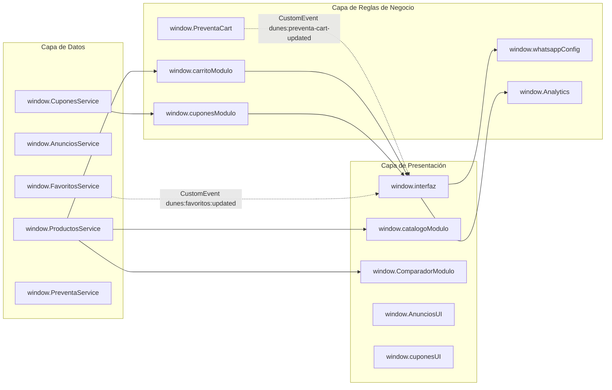

# 04-JAVASCRIPT-Y-EVENTOS.md
# ARQUITECTURA JAVASCRIPT, EVENTOS, ESTADOS Y FLUJO DE EJECUCIÓN

---

## 1. Inventario Técnico de Archivos JavaScript

El directorio `js/` contiene 21 archivos JavaScript nativos organizados por capas funcionales:

| Archivo | Tamaño | Responsabilidad Principal | Objetos / Métodos Globales Expuestos |
| :--- | :--- | :--- | :--- |
| `config.js` | 2.1 KB | Centralización de constantes de configuración y URLs de Google Sheets (CSVs). | `window.CONFIG`, `CONFIG_CUPONES`, `CONFIG_ANUNCIOS`, `CONFIG_PREVENTA` |
| `productos-service.js` | 22.5 KB | Servicio central de carga y parseo de catálogo desde Google Sheets con fallback a JSON. | `window.ProductosService`, `window.resolverImagen` |
| `productos.js` | 4.8 KB | Consultas del catálogo, destacados y rotación de oferta especial en Home. | `window.productosModulo` |
| `carrito.js` | 25.9 KB | Lógica de carrito, cálculo de stock/ml, modales, toasts y persistencia. | `window.carritoModulo`, `mostrarModalAgregarCarrito`, `mostrarToastPremium` |
| `interfaz.js` | 202.5 KB | Monolito UI: navegación responsive, drawer, sticky header, detalle producto, SEO dinámico, checkout y WhatsApp. | `window.interfaz`, `window.cuponesCheckout`, `renderizarCarritoDOM`, `confirmarPedidoWhatsApp` |
| `catalogo.js` | 63.5 KB | Lógica del catálogo: filtros por formato, tipo, género, ocasión, ordenación y sessionStorage. | `window.catalogoModulo` |
| `cupones-service.js` | 11.1 KB | Servicio de consulta y parseo de cupones desde Google Sheets. | `window.cuponesService` |
| `cupones.js` | 12.2 KB | Motor de validación comercial y matemática de descuentos de cupones. | `window.cuponesModulo` |
| `cupones-ui.js` | 10.9 KB | Controlador de interfaz de cupones (input, botón, spinner, feedback). | `window.cuponesUI` |
| `comparador.js` | 29.8 KB | Controlador de comparación olfativa, dropdowns excluyentes y compra directa. | `window.ComparadorModulo` |
| `favoritos-service.js` | 9.9 KB | Servicio de persistencia y eventos para la lista de deseos (`dunes_favoritos`). | `window.FavoritosService` |
| `favoritos-page.js` | 20.3 KB | Renderizado de cuadrícula de favoritos y sincronización reactiva. | Ámbito local / escuchador de eventos |
| `preventa-service.js` | 21.2 KB | Servicio de carga de productos y configuración de Preventa desde Sheets. | `window.PreventaService`, `module.exports` |
| `preventa.js` | 6.6 KB | Filtros y buscador de la landing de Preventa. | `window.PreventaFilters`, `module.exports` |
| `preventa-cart.js` | 33.1 KB | Motor puro de reservas de Preventa (`dunes_preventa_cart`) y adelanto S/10. | `window.PreventaCart`, `global.PreventaCart` |
| `preventa-reserva.js` | 27.6 KB | Controlador de checkout de Preventa y formateador de mensaje WhatsApp. | `window.PreventaReserva`, `global.PreventaReserva` |
| `anuncios-service.js` | 7.0 KB | Carga de anuncios activos desde Google Sheets. | `window.AnunciosService` |
| `anuncios-ui.js` | 6.5 KB | Inserción en DOM y rotación automática de la barra de anuncios. | `window.AnunciosUI` |
| `whatsapp.js` | 8.8 KB | Teléfono oficial, generador y sanitizador de mensajes de pedido de WhatsApp. | `window.whatsappConfig` |
| `ayuda.js` | 17.9 KB | Acordeón FAQ, buscador de preguntas y carrusel/lightbox de referencias. | Ámbito local con escuchadores de DOM |
| `analytics.js` | 8.4 KB | Capa de seguimiento GA4 + Clarity libre de datos personales (Zero PII). | `window.Analytics`, `module.exports` |

---

## 2. Inicialización y Ciclo de Vida del DOM

Todas las páginas inicializan sus componentes a través de escuchadores estándar:

```javascript
document.addEventListener('DOMContentLoaded', () => {
    // 1. Menú Drawer Móvil con control de accesibilidad ARIA e inert
    inicializarMenuMovil();

    // 2. Encabezado Sticky con detección de scroll (> 20px)
    inicializarStickyHeader();

    // 3. Scroll Reveal mediante IntersectionObserver nativo
    inicializarScrollReveal();

    // 4. Si la página contiene elementos específicos, inicializa sus módulos:
    //    - index.html: cargarProductosDestacadosHome(), cargarOfertaEspecialHome()
    //    - catalogo.html: inicializarCatalogo()
    //    - producto.html: cargarDetalleProducto()
    //    - carrito.html: renderizarCarritoDOM(), inicializarCheckoutForm()
    //    - ayuda.html: inicializarAcordeonFAQ(), cargarYRenderizarReferencias()
    //    - comparador.html: configurarBotoneraModos(), cargarProductos()
    //    - favoritos.html: inicializarPaginaFavoritos()
});
```

Además, páginas que dependen de navegación hacia atrás o adelante (como `favoritos.html` y `catalogo.html`) escuchan el evento `pageshow` en `window` (`window.addEventListener('pageshow', ...)`) para restaurar la cuadrícula y el scroll si el usuario regresa mediante el historial del navegador (`bfcache`).

---

## 3. Matriz de Scripts y Eventos por Página

| Página | Listeners Principales en el DOM | Eventos Personalizados Emitidos / Escuchados |
| :--- | :--- | :--- |
| `index.html` | `click` en `#mobile-menu-toggle`, `click` en `#whatsapp-floating-btn`, `click` en `.btn-add-cart` (destacados), `click` en `.btn-favorite-toggle`, `scroll` en `window`. | Escucha `dunes:favoritos:updated` para actualizar `#favorites-count`. |
| `catalogo.html` | `input` con debounce en `#catalog-search-input`, `click` en pestañas de formato, `change` en selectores de tipo, género, ocasión y orden, `change` en checkbox `#filter-available-only`, `click` en `#catalog-clear-filters`. | Guarda en `sessionStorage` (`dunes_catalog_state`). Dispara `Analytics.trackCatalogSearch()`. |
| `producto.html` | `click` en selector de miniaturas, `click` en `.decant-pill`, `click` en `#btn-add-to-cart-detail`, `click` en badge "VER FICHA" (abre lightbox), `scroll` (activa `.mobile-purchase-bar`). | Emite `Analytics.trackAddToCart()`. |
| `carrito.html` | `click` en `.qty-btn-plus` y `.qty-btn-minus` (con semáforo anti-concurrencia), `click` en `.btn-remove-item`, `click` en `#btn-vaciar-carrito`, `click` en `.delivery-method-card`, `click` en `.delivery-zone-card`, `input` en `#coupon-code`, `click` en `#coupon-apply-btn`, `click` en `#btn-confirmar-whatsapp`. | Emite `Analytics.trackViewCart()`, `Analytics.trackShippingInfo()`, `Analytics.trackLead()`. |
| `favoritos.html` | `click` en `.favorite-toggle-btn` (remover en vivo), `click` en `.btn-add-cart`. | Escucha evento nativo `storage` de `window` (sincroniza pestañas en tiempo real) y `dunes:favoritos:updated`. |
| `comparador.html` | `click` en `#btn-mode-sellados` / `#btn-mode-decants`, `focus` e `input` en `.comparator-search-input`, `pointerdown` en `.comparator-dropdown-item`, `click` en `.btn-change-compact`, `click` en `.decant-pill`, `click` en `.btn-add-compact`. | Llama a `closeComparatorDropdowns()` y `verificarSingleDropdownState()`. |
| `ayuda.html` | `input` en `#faq-search-input`, `click` en `.faq-button`, `click` en `#carousel-prev-btn` / `#carousel-next-btn`, `scroll` en `#carousel-track-container`, `click` en `#btn-open-all-references`, `keydown` (Escape, flechas) en lightbox. | Gestiona navegación interna de imágenes en lightbox. |
| `preventa/index.html` | `click` en `.preventa-card-btn` (reservar), `click` en filtros de preventa, `click` en `#preventa-modal-btn`, `click` en `#preventa-confirm-btn-view`. | Emite `dunes:preventa-cart-updated` para sincronizar badges de cabecera. |
| `preventa/reserva/` | `click` en botones de cantidad de reserva, `click` en eliminar reserva, `click` en `#btn-confirmar-reserva-whatsapp`. | Emite aviso `#preventa-stock-toast` si se supera el stock disponible. |

---

## 4. Comunicación Entre Scripts y Estado Global

Dado que no se utilizan empaquetadores (Vite/Webpack), la comunicación se realiza mediante **Namespaces Globales Explícitos en `window`** y **CustomEvents**:



---

## 5. Recorrido Paso a Paso de un Flujo Comercial Completo

A continuación se detalla con precisión quirúrgica el flujo de datos y ejecución desde que el usuario navega hasta que se genera la orden en WhatsApp:

```
[1. Usuario en catalogo.html]
    │
    ├── Hace clic en "Agregar al carrito" en un perfume sellado (ej. Khamrah Clasico, ID: p1)
    │
[2. Ejecución en js/carrito.js]
    │
    ├── agregarAlCarrito('p1', 1, null)
    ├── Consulta producto: window.productosModulo.obtenerProductoPorId('p1')
    ├── Valida: product.disponible === true && product.stock >= 1
    ├── Lee localStorage: dunes_cart
    ├── Verifica si 'p1' ya existe en dunes_cart:
    │     - Si existe: nuevaCantidad = actual + 1 (valida contra stock físico)
    │     - Si no existe: inserta nuevo objeto con precio regular u oferta
    ├── Guarda en localStorage: dunes_cart
    ├── Llama a actualizarContadorCarrito() -> incrementa badge numérico
    ├── Llama a animarBotonCarritoHeader() -> clase .is-cart-animated
    ├── Llama a Analytics.trackAddToCart() -> evento GA4 y Clarity
    └── Muestra notificación toast y abre modal de confirmación (#cart-added-modal)
    │
[3. Usuario navega hacia carrito.html]
    │
    ├── DOMContentLoaded ejecuta renderizarCarritoDOM() en js/interfaz.js
    ├── Renderiza fila de 'p1' con precio S/ 155.00 y selector de cantidad
    ├── Lee cupones persistidos en sessionStorage ('dunes_cupon_aplicado')
    │
[4. Usuario aplica Cupón de Descuento (ej. "TIODUNES")]
    │
    ├── Click en #coupon-apply-btn -> ejecutarAplicacionCupon() en js/cupones-ui.js
    ├── Botón muestra estado VERIFICANDO...
    ├── Llama a window.cuponesCheckout.aplicarCupon("TIODUNES")
    ├── CuponesModulo.validarCuponPorCodigo() valida contra CuponesService
    ├── Verifica: activo === true, fecha no vencida, subtotal >= montoMinimo
    ├── Calcula descuento: Math.min(valor, subtotal) -> Descuento S/ 10.00
    ├── Guarda en sessionStorage ('dunes_cupon_aplicado')
    └── Sincroniza interfaz: muestra "Ahorras S/ 10.00" y actualiza totales
    │
[5. Usuario selecciona Modalidad y Zona de Entrega]
    │
    ├── Click en tarjeta "Delivery local"
    ├── Despliega cuadrícula de zonas
    ├── Click en "Tarapoto Central" -> tarifa S/ 7.00 (o Gratis si subtotal >= S/ 150)
    ├── Ingresa Nombre: "Carlos Mendoza", Dirección: "Jr. San Martín 234"
    │
[6. Confirmación del Pedido]
    │
    ├── Click en #btn-confirmar-whatsapp -> confirmarPedidoWhatsApp(e)
    ├── Valida formulario: validarFormularioEntrega() -> 100% Completo
    ├── Construye objeto final:
    │     {
    │       productos: [...],
    │       subtotalBruto: 155.00,
    │       cuponAplicado: { codigo: "TIODUNES", descuento: 10.00 },
    │       costoEntrega: 0.00, // Gratis por superar S/ 150
    │       totalFinal: 145.00,
    │       datosEntrega: { tipoEntrega: "delivery-local", zona: "tarapoto-central", ... }
    │     }
    ├── Llama a Analytics.trackLead()
    ├── Llama a whatsappConfig.enviarPedidoWhatsApp() en js/whatsapp.js
    ├── Genera texto limpio sin emojis:
    │     "Hola, *Dunes Parfums*
    │      Deseo realizar el siguiente pedido:
    │      *PRODUCTOS*
    │      • 1 x Khamrah Clasico — 100 ml — S/155.00
    │      *RESUMEN DEL PEDIDO*
    │      Subtotal de productos: S/155.00
    │      Cupón aplicado: TIODUNES
    │      Descuento: -S/10.00
    │      Subtotal con descuento: S/145.00
    │      Tipo de entrega: Delivery local
    │      Zona: Tarapoto Central
    │      Costo de delivery: GRATIS
    │      *TOTAL DEL PEDIDO: S/145.00*
    │      *DATOS DEL CLIENTE*
    │      Nombre: Carlos Mendoza
    │      Dirección: Jr. San Martín 234"
    └── Abre https://wa.me/51986510573?text=... en WhatsApp oficial
```

---

## 6. Funciones Duplicadas, Legacy o sin Uso Detectadas

Durante la auditoría estática del código se identificaron los siguientes puntos de atención:

1. **Utilidades de Normalización de Texto Repetidas**:
   - La función `normalizarTexto()` (que aplica `.toLowerCase().normalize('NFD').replace(/[\u0300-\u036f]/g, '').trim()`) se encuentra reimplementada independientemente en `js/catalogo.js`, `js/comparador.js`, `js/cupones-service.js`, `js/preventa.js` e `js/interfaz.js`.
   - *Diagnóstico*: No genera conflicto porque están encapsuladas dentro de IIFEs o scopes aislados, pero representa código repetido que podría unificarse en una librería de utilidades en etapas futuras.
2. **Parser CSV Múltiple**:
   - `parseCSV()` se encuentra implementado en `js/productos-service.js`, `js/cupones-service.js`, `js/anuncios-service.js` y `js/preventa-service.js`. Cada uno mantiene su propia versión.
   - *Diagnóstico*: Garantiza total independencia entre módulos (si la hoja de cupones cambia, no rompe productos), pero duplica ~50 líneas de código idéntico en 4 archivos.
3. **Control del Drawer Móvil en Preventa**:
   - `preventa/index.html` y `preventa/reserva/index.html` incluyen un bloque `<script>` inline con la lógica del drawer móvil en lugar de importar `interfaz.js`.
   - *Razón de diseño*: Se hizo intencionalmente para no cargar el monolito de 202 KB de `interfaz.js` (que busca elementos del Home/Carrito que no existen en Preventa), manteniendo la Preventa ultraligera.
