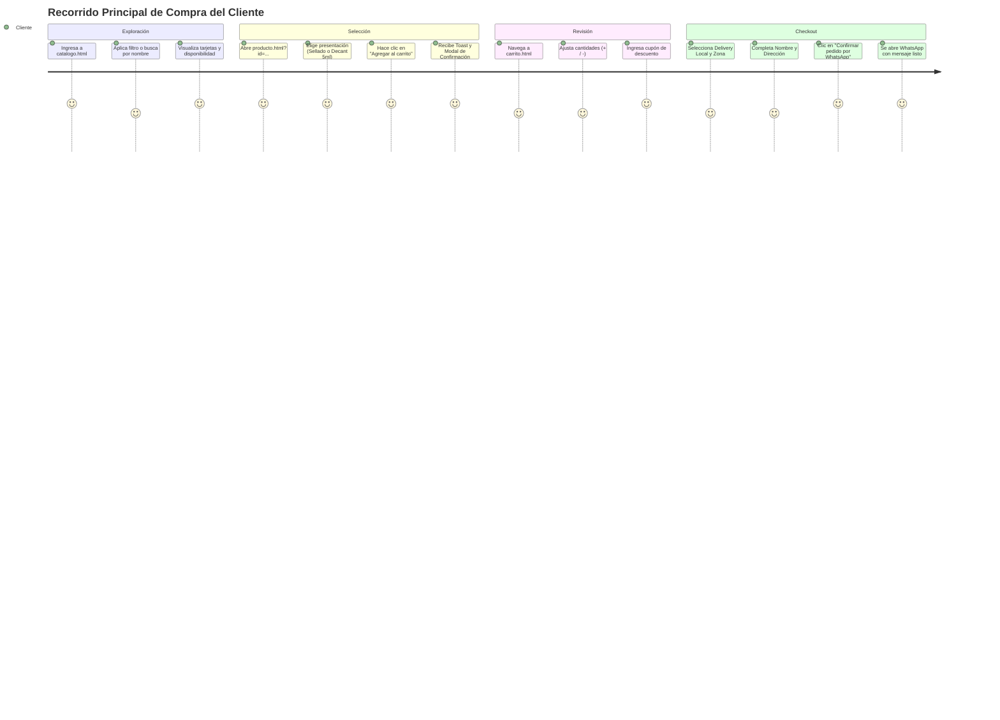
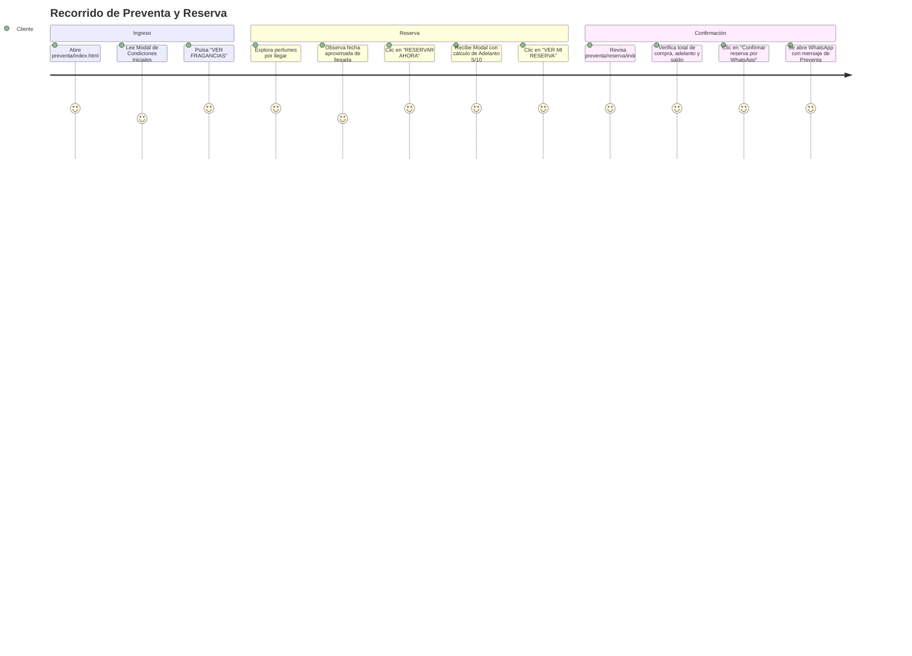

# 07-FLUJOS-DE-USUARIO.md
# RECORRIDOS FUNCIONALES COMPLETOS DESDE LA PERSPECTIVA DEL CLIENTE

En este documento se documentan los 7 flujos de usuario verificados en código, detallando cada paso, interacción visual y el punto exacto de finalización.

---

## 1. Flujo Principal de Compra (Catálogo $\rightarrow$ Carrito $\rightarrow$ WhatsApp)



### Paso a Paso Técnico:
1. **Paso 1: Entrada**: El cliente ingresa a `catalogo.html` o hace clic en una categoría desde `index.html`.
2. **Paso 2: Búsqueda y Filtros**:
   - Escribe en el buscador o selecciona filtros de género ("Hombre"), categoría ("Árabe") u ocasión ("Noche").
   - La cuadrícula se actualiza en tiempo real sin recargar la página.
3. **Paso 3: Visualización de Ficha**:
   - Clic en la tarjeta abre `producto.html?id={id}`.
   - Si es Decant: El usuario hace clic en la pastilla `5 ML` (o `3 ML`, `10 ML`). El precio cambia instantáneamente de S/ 15.00 a S/ 20.00.
4. **Paso 4: Adición al Pedido**:
   - Clic en "AGREGAR AL CARRITO".
   - `carrito.js` verifica si hay mililitros suficientes.
   - El icono del carrito en el header pulsa (`.is-cart-animated`) y el contador numérico sube.
   - Se muestra un toast verde y se abre `#cart-added-modal`. El usuario elige "Ir al carrito" o "Seguir comprando".
5. **Paso 5: Revisión de Carrito (`carrito.html`)**:
   - El usuario visualiza la tabla de compras.
   - Puede incrementar unidades (el botón `+` se bloquea automáticamente si se alcanza el stock máximo del producto).
6. **Paso 6: Aplicación de Cupón**:
   - Escribe "TIODUNES" en `#coupon-code` y presiona Enter o "Aplicar".
   - El botón muestra `VERIFICANDO...` y luego se actualiza la tarjeta de totales restando el descuento en color dorado.
7. **Paso 7: Selección de Entrega**:
   - Clic en tarjeta "Delivery local" $\rightarrow$ se despliegan las 6 zonas de San Martín.
   - Clic en "Tarapoto Central" $\rightarrow$ tarifa S/ 7.00 (o GRATIS si el subtotal supera S/ 150.00).
   - Completa Nombre y Dirección.
8. **Paso 8: Finalización del Flujo**:
   - Clic en "Confirmar pedido por WhatsApp".
   - El sistema valida que ningún campo obligatorio falte.
   - Se abre la aplicación oficial de WhatsApp con el mensaje pre-estructurado.
   - **Punto Final del Flujo en la Web**: La aplicación web transfiere la sesión al chat de WhatsApp (`wa.me/51986510573`). La transacción monetaria y la entrega se gestionan manualmente con el asesor comercial.

---

## 2. Flujo de Lista de Deseos (Favoritos)

1. **Marcado de Favorito**: En cualquier tarjeta del catálogo o en la página de producto, el usuario hace clic en el botón de corazón (`.favorite-toggle-btn`).
2. **Reactividad**:
   - El corazón se rellena de dorado (`.is-active`).
   - Se muestra un toast breve: *"Agregado a tus favoritos"*.
   - El contador `#favorites-count` en la cabecera se incrementa en todas las pestañas abiertas.
3. **Revisión en `favoritos.html`**:
   - Al abrir la página, `favoritos-page.js` lee los IDs de `localStorage` y recupera los datos del catálogo.
   - El cliente puede hacer clic en "Agregar al carrito" directamente desde sus favoritos.
4. **Desmarcado**: Al volver a presionar el corazón, la tarjeta se desvanece de la cuadrícula. Si la lista queda vacía, aparece el estado vacío invitando a explorar el catálogo.
- **Punto Final del Flujo**: Compra de los favoritos agregándolos al carrito o vaciado de la lista.

---

## 3. Flujo del Comparador Olfativo Cara a Cara

1. **Ingreso a `comparador.html`**: El usuario selecciona el modo (Sellados o Decants).
2. **Búsqueda Perfume 1**:
   - Hace foco en el buscador de la izquierda.
   - El dropdown muestra las primeras fragancias con ficha olfativa disponible.
   - Escribe "Khamrah" y hace clic en "Khamrah Clasico".
   - La columna izquierda muestra la imagen de las notas olfativas, el precio y el botón "VER FICHA".
3. **Búsqueda Perfume 2**:
   - Hace foco en la columna derecha.
   - El desplegable de la izquierda se cierra automáticamente. "Khamrah Clasico" ya no aparece disponible en esta columna.
   - Selecciona "Honor and Glory".
4. **Comparación Visual**:
   - El usuario compara lado a lado las notas y familias aromáticas de ambas fragancias.
   - Puede hacer clic en "VER FICHA" para abrir cualquiera de las dos en pantalla completa en el Lightbox.
5. **Conversión Directa**:
   - Decide comprar una de ellas, elige cantidad y pulsa "AGREGAR".
   - El producto pasa inmediatamente a `dunes_cart` sin salir del comparador.
- **Punto Final del Flujo**: El usuario continúa comparando otras opciones o se dirige al carrito para cerrar su pedido.

---

## 4. Flujo de Preventa Exclusiva y Reserva Anticipada



1. **Ingreso a `/preventa/`**: El usuario es recibido por el modal que explica que la preventa requiere S/ 10.00 de adelanto para congelar el precio de lanzamiento.
2. **Exploración**: Filtra por género u ocasión ("Citas,Noche"). Observa el estado del producto (`PREVENTA ABIERTA` o `ÚLTIMAS RESERVAS`).
3. **Separación**:
   - Clic en "RESERVAR AHORA".
   - Se valida el stock disponible en la hoja de cálculo.
   - Se despliega `#preventa-confirm-modal` mostrando el desglose financiero exacto:
     - Adelanto a abonar hoy: S/ 10.00.
     - Saldo pendiente al recibir el producto: S/ 119.00 (por ejemplo).
4. **Revisión en `/preventa/reserva/`**:
   - El cliente revisa las unidades reservadas.
   - Si aumenta a 2 unidades, el adelanto requerido sube automáticamente a S/ 20.00 y el saldo se recalcula.
5. **Cierre de Reserva**:
   - Clic en "Confirmar reserva por WhatsApp".
   - Se abre WhatsApp con el mensaje estructurado solicitando los datos bancarios para transferir el adelanto.
- **Punto Final del Flujo**: El cliente coordina la transferencia del adelanto de S/ 10 por chat con el asesor para congelar su pedido.

---

## 5. Flujo de Cotización de Fragancias Agotadas o No Listadas

1. **Situación A (Catálogo sin stock)**: El cliente aplica filtros en `catalogo.html` que no devuelven productos disponibles.
2. **Situación B (Búsqueda infructuosa)**: Busca una fragancia que Dunes Parfums no tiene en catálogo.
3. **Aparición del Bloque de Cotización (`#catalog-cotizacion-block`)**:
   - Se despliega un contenedor elegante adaptado a la categoría ("¿No encuentras el perfume árabe que buscas? Cotízalo con nosotros y te ayudamos a conseguirlo").
4. **Activación de Cotización**:
   - Clic en el botón "Cotiza aquí tu perfume".
   - Abre WhatsApp con una plantilla pre-redactada:
     ```
     Hola, visité su catálogo, pero no encontré el perfume que busco.
     Deseo cotizar un perfume.
     Nombre del perfume:
     Marca:
     Presentación:
     ```
- **Punto Final del Flujo**: El cliente completa los nombres en WhatsApp y el asesor responde con precio y tiempo de importación bajo pedido.

---

## 6. Flujo de Galería de Confianza, Referencias y FAQ (`ayuda.html`)

1. **Dudas Frecuentes**: El cliente escribe "envíos" en el buscador de `ayuda.html`. Las preguntas no coincidentes se ocultan en tiempo real. Clic en la pregunta despliega la respuesta en el acordeón.
2. **Inspección de Referencias Reales**:
   - En el carrusel de referencias, el usuario observa fotos reales de paquetes entregados en Tarapoto y despachados por Olva Courier / Shalom.
   - Clic en cualquier foto abre el Lightbox modal a pantalla completa.
   - Puede navegar fotos con las flechas del teclado o botones táctiles.
3. **Galería Completa**:
   - Clic en "Ver todas las referencias" abre el modal con filtros por pestañas (Entregas, Envíos, Decants).
- **Punto Final del Flujo**: El usuario adquiere confianza y pulsa el botón flotante o regresa al catálogo a comprar.
