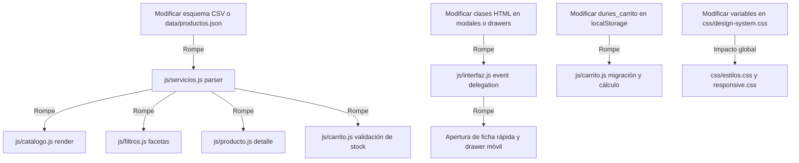

# 09 - HOJA DE RUTA Y RECOMENDACIONES TÉCNICAS

Este documento establece la hoja de ruta técnica priorizada, directrices de preservación de código, análisis de riesgos de rotura y recomendaciones arquitectónicas para los desarrolladores o inteligencias artificiales (ChatGPT) que continúen la evolución del catálogo digital de **DUNES PARFUMS**.

---

## 1. PRINCIPIOS INQUEBRANTABLES: QUÉ SE DEBE PRESERVAR

Al realizar cualquier mantenimiento o extensión en el proyecto, los siguientes pilares de diseño y arquitectura **NO deben ser alterados ni reemplazados**:

1. **Arquitectura JAMstack Estática y Cero Servidor Backend:**
   - El proyecto corre en GitHub Pages y servidores estáticos estándar (XAMPP / Apache / Nginx / Vercel).
   - **No introducir** dependencias de Node.js en tiempo de ejecución (como Express, NestJS, SSR en Next.js, etc.) a menos que el propietario migre formalmente de infraestructura de hosting. Todo el runtime debe continuar funcionando en el navegador cliente mediante ES6+ vanilla.
2. **Estrategia Híbrida de Datos (Google Sheets CSV + JSON Local):**
   - El fallback transparente de red (Google Sheets -> Fallback Local JSON en `data/`) es vital para la resiliencia del negocio ante caídas de conexión o cambios de API de Google.
   - El esquema de nombres de columnas en español (`ID`, `NOMBRE`, `MARCA`, `GENERO`, `PRECIO_DECANT_3ML`, `STOCK`, etc.) está acoplado a la hoja operativa del cliente.
3. **Mecanismo de Checkout sin Pasarela Bancaria (WhatsApp API):**
   - El proceso de compra culmina en un mensaje estructurado de WhatsApp al número oficial `+51 986510573`.
   - **Regla crítica:** No incorporar emojis en los strings del mensaje de WhatsApp generado por código. En `js/carrito.js`, los emojis causan problemas de encoding en ciertos navegadores móviles antiguos (`%F0%9F...`). Mantener texto limpio con saltos de línea estándar (`\n` encodeado a `%0A`).
4. **Separación Estricta del Módulo de Preventa:**
   - La preventa (`/preventa/` y `/preventa/reserva/`) opera de forma intencionalmente aislada del catálogo general: almacena en `dunes_preventa_cart`, maneja adelantos fijos de S/ 10.00 y no debe mezclarse con el carrito principal (`dunes_carrito`).
5. **Algoritmo de Stock de Decants por Capacidad de Mililitros:**
   - No forzar stock unitario en decants. El cálculo dinámico resta los mililitros consumidos por todas las presentaciones (3ml, 5ml, 10ml) del total disponible (`mililitrosDisponibles`).

---

## 2. MAPA DE FRAGILIDAD: QUÉ MÓDULOS REQUIEREN MAYOR CUIDADO

| Módulo / Archivo | Nivel de Fragilidad | Razón de la Fragilidad | Consecuencia si se rompe |
| :--- | :---: | :--- | :--- |
| `js/interfaz.js` | **CRÍTICO** | Monolito de 4,603 líneas con alto acoplamiento DOM, selectores CSS directos y timers de polling. | Fallan los modales, el drawer móvil, el banner flotante, el comparador y las vistas de producto. |
| `js/carrito.js` | **CRÍTICO** | Lógica de cálculo de precios, envío por zonas (San Martín), cupones, decants y serialización WhatsApp. | Clientes no pueden finalizar compras o se envían pedidos con montos erróneos. |
| `js/servicios.js` | **ALTO** | Proveedor de datos del catálogo general con caché en memoria (`_catalogoCache`). | El catálogo, buscador y filtros quedan vacíos (pantalla en blanco o spinners eternos). |
| `js/filtros.js` | **MEDIO-ALTO** | Filtros combinados multi-criterio y ordenamiento por relevancia y precio. | Los usuarios no pueden encontrar productos o la paginación muestra resultados inconsistentes. |
| `css/responsive.css` y `css/estilos.css` | **ALTO** | Hojas de estilo extensas (~180 KB cada una) con reglas `!important` y selectores anidados complejos. | Regresiones visuales en dispositivos móviles (desbordamiento horizontal, modales rotos). |

---

## 3. DEPENDENCIAS QUE PODRÍAN ROMPERSE AL MODIFICAR OTROS ARCHIVOS



### Reglas de Prevención de Roturas:
1. **Nunca cambiar los IDs HTML de elementos clave**: Elementos como `#lista-productos`, `#carrito-items`, `#btn-checkout`, `#total-carrito`, `#search-input`, `#filtro-genero` son consultados directamente por los scripts.
2. **Mantener compatibilidad dual snake_case / camelCase en objetos de producto**:
   - Siempre leer campos con fallback: `const precio = prod.precio_oferta ?? prod.precioOferta ?? prod.precio;`.
3. **No alterar las funciones exportadas en `window`**:
   - `window.serviciosDatos`
   - `window.anunciosPublicidad`
   - `window.gestorFiltros`
   - `window.renderCatalogo`
   - `window.agregarAlCarrito` / `window.abrirModalProducto`
   Si se refactoriza a módulos ES6 (`import/export`), debe asegurarse un shim en `window` o refactorizar todos los scripts simultáneamente.

---

## 4. COMPONENTES Y LÓGICAS REUTILIZABLES DISPONIBLES

Cualquier nueva funcionalidad debe apoyarse en las utilidades probadas ya existentes en lugar de reimplementarlas:

1. **Formateo de Moneda:**
   - Función: `formatearPrecio(monto)` en `js/servicios.js` y `js/carrito.js`. Formatea con `S/` y dos decimales fijos (`S/ 120.00`).
2. **Normalización de Texto para Búsquedas:**
   - Quita diacríticos, acentos y convierte a minúsculas: `.normalize('NFD').replace(/[\u0300-\u036f]/g, '').toLowerCase()`.
3. **Manejo de Notificaciones Toast:**
   - `mostrarNotificacion(mensaje, tipo)` implementado en `js/interfaz.js` y `js/carrito.js`. Inserta toasts animados flotantes y accesibles.
4. **Cálculo de Envíos:**
   - Tabla de costos de envío y reglas de tarifa cero para San Martín en `js/carrito.js` (`ZONAS_TARAPOTO` y `COSTO_ENVIO_NACIONAL`).
5. **Componente de Tarjeta de Producto:**
   - Generación de HTML dinámico en `js/catalogo.js` (`crearTarjetaProductoHTML`). Reutilizar las mismas clases CSS (`.producto-card`, `.producto-badge`, `.producto-precio`) para mantener la coherencia estética.

---

## 5. HOJA DE RUTA PRIORIZADA (FASES TÉCNICAS)

### FASE 1: Estabilización y Calidad Inmediata (Prioridad Alta)
- [ ] **Unificar Parsers CSV y Normalizadores de Texto:**
  - Extraer las funciones idénticas duplicadas en `js/servicios.js`, `js/cupones.js`, `js/anuncios.js` y `js/preventa-service.js` hacia una utilidad compartida ligera (ej. `js/utils-parser.js`).
- [ ] **Desacoplamiento Gradual de `js/interfaz.js`:**
  - Separar el archivo de 4,603 líneas en submódulos lógicos:
    - `js/ui/modales.js` (modal de producto, comparador, guía de decants).
    - `js/ui/drawer-movil.js` (menú lateral, barra de navegación móvil).
    - `js/ui/banners.js` (anuncios flotantes y ticker superior).
    - `js/ui/accesibilidad.js` (gestión de focos, lectores de pantalla).
- [ ] **Alineación de Scripts en Preventa:**
  - Reemplazar los scripts inline de `preventa/index.html` y `preventa/reserva/index.html` por archivos dedicados (`js/preventa-ui.js`), eliminando la duplicación del drawer móvil.

### FASE 2: Completitud Funcional de Módulos Incompletos (Prioridad Media)
- [ ] **Conexión de Recomendaciones de IA en Ficha de Producto:**
  - Conectar el contenedor `#recomendados-ia` de `producto.html` con un algoritmo de similitud por notas olfativas y familia olfativa basado en `data/productos.json`.
- [ ] **Finalización de Filtros en `favoritos.html`:**
  - Conectar los selectores visuales de género y marca en la vista de favoritos para filtrar la lista de productos guardados.
- [ ] **Consistencia en Paginación / Scroll Infinito:**
  - Decidir y unificar entre la paginación tradicional por botones o scroll infinito con IntersectionObserver para la navegación de productos en el catálogo.

### FASE 3: Rendimiento y Optimización de Carga (Prioridad Media)
- [ ] **Optimización de Hojas de Estilo CSS:**
  - Auditar `css/estilos.css` y `css/responsive.css` para eliminar selectores duplicados o reglas obsoletas.
  - Generar un bundle minificado para producción manteniendo los archivos legibles en desarrollo.
- [ ] **Carga Diferida de Imágenes y WebP:**
  - Asegurar atributos `loading="lazy"` y `decoding="async"` en todas las tarjetas de producto generadas dinámicamente.
  - Implementar etiquetas `<picture>` con alternativas WebP/AVIF para reducir el consumo de datos móviles.

### FASE 4: Funcionalidades Avanzadas Futuras (Prioridad Baja / Evolutiva)
- [ ] **Exportación / Compartir Lista de Comparador:**
  - Permitir a los usuarios compartir el enlace de comparación de dos perfumes mediante URL con parámetros (`?comparar=ID1,ID2`).
- [ ] **Soporte Offline PWA:**
  - Registrar un Service Worker básico para permitir navegación del catálogo en modo lectura y acceso a la información de contacto sin conexión a internet.
- [ ] **Historial de Pedidos Local:**
  - Guardar en `localStorage` un resumen de los últimos pedidos enviados por WhatsApp para que el cliente pueda consultar su historial de compras en `carrito.html`.

---

## 6. PROTOCOLO DE TESTING ANTES DE CADA DEPLOYMENT

Para garantizar que ningún cambio rompa el comportamiento existente, ejecutar rigurosamente el siguiente protocolo:

```bash
# 1. Ejecución del test suite completo (373 tests unitarios)
node --test tests/*.test.js

# 2. Verificación de archivos específicos si se tocó el carrito
node --test tests/cart-core.test.js tests/delivery-method-card-click.test.js tests/free-shipping-threshold.test.js

# 3. Verificación de decants si se tocaron servicios o catálogo
node --test tests/decant-stock.test.js tests/decants-filter.test.js tests/erba-pura-nicho.test.js

# 4. Verificación de preventa si se tocó el flujo de reserva
node --test tests/preventa-service.test.js tests/preventa-reserva.test.js
```

### Checklist Manual en Navegador (Pruebas de Humo):
1. Abrir `index.html` en Chrome Desktop y emulación móvil (iPhone / Pixel).
2. Verificar que el banner de anuncios cargue o use fallback sin errores en consola.
3. Buscar "Erba Pura" en el buscador y verificar que aparezca la tarjeta de producto.
4. Abrir la ficha de un perfume en decants, seleccionar 5ml y añadir al carrito.
5. Ir a `carrito.html`, aplicar cupón `BIENVENIDA`, seleccionar envío a Tarapoto (Morales), completar formulario y hacer click en "Finalizar pedido por WhatsApp".
6. Verificar que la URL de WhatsApp se genere correctamente con todos los datos y montos cuadrados.
7. Abrir `preventa/index.html`, agregar un perfume en preventa, ir a `preventa/reserva/index.html` y comprobar el cálculo del adelanto de S/ 10.00.
