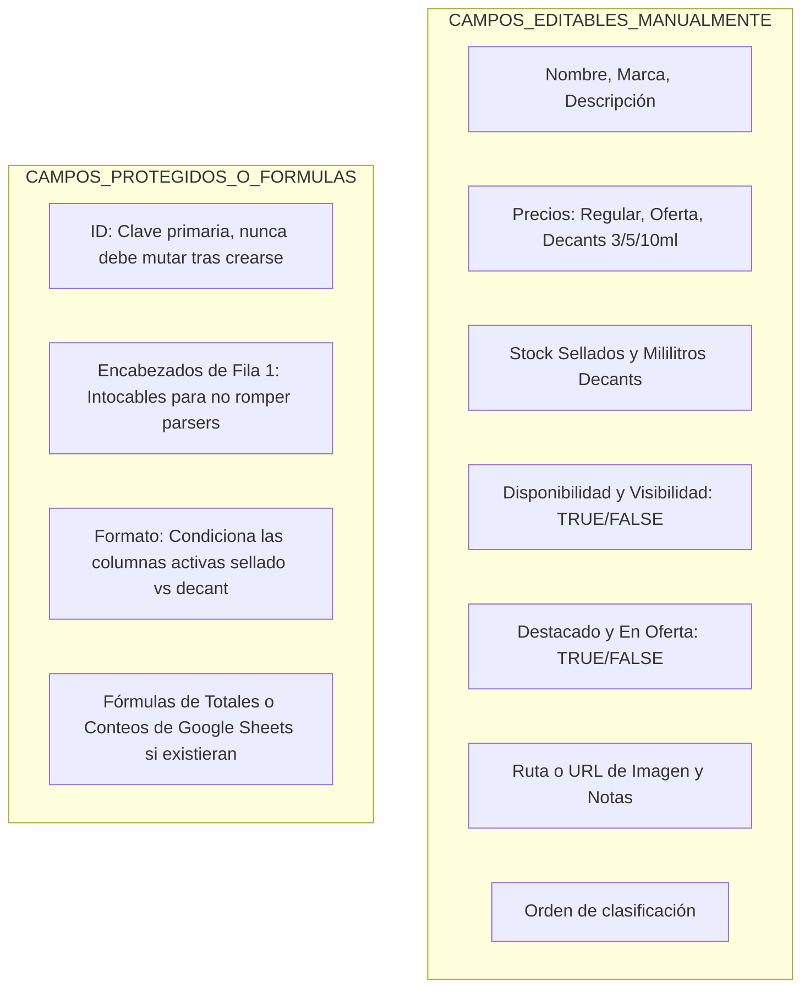
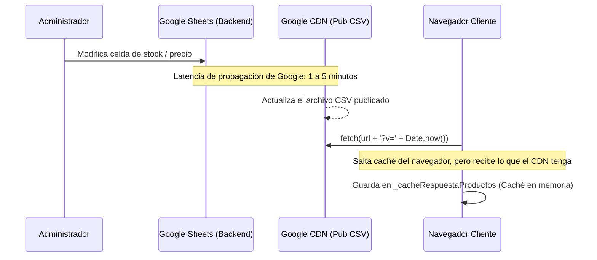
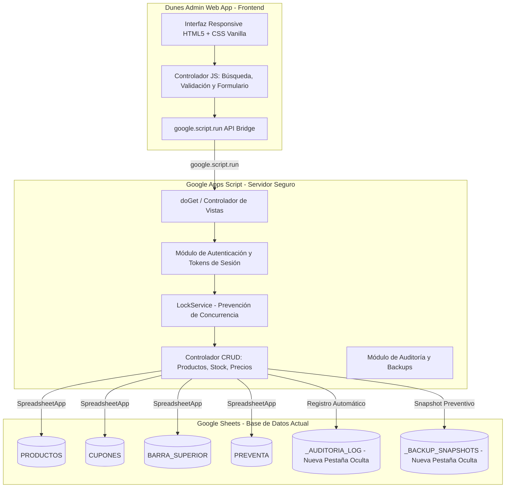
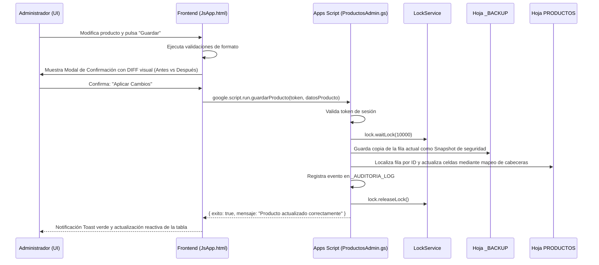

# DUNES PARFUMS ADMIN — FASE 1: ANÁLISIS, DIAGNÓSTICO Y PLAN DE ARQUITECTURA

**Proyecto:** Panel Administrativo Privado para *Dunes Parfums*  
**Autor:** Arquitecto de Software Senior  
**Estado:** Fase 1 — Análisis y Planificación (Solo Lectura, Sin Modificación de Código de Producción)  
**Fecha:** Octubre 2026  
**Documento:** `PLAN-DUNES-ADMIN.md`

---

## RESUMEN EJECUTIVO

El presente documento establece el diagnóstico exhaustivo de la base de datos distribuida en **Google Sheets**, el funcionamiento de los mecanismos de sincronización del catálogo web público existente y el diseño de arquitectura técnica para el desarrollo de un **Panel Administrativo Privado (Dunes Parfums Admin)**.

El panel administrativo propuesto se ejecutará **100% dentro del ecosistema gratuito de Google** mediante **Google Apps Script (HTML Service)** enlazado directamente al libro de cálculo actual, con una interfaz web responsive (PC y smartphones), comunicación cliente-servidor mediante `google.script.run`, control estricto de concurrencia (`LockService`), auditoría de cambios y autenticación protegida adaptada a cuentas de Gmail personal.

> [!IMPORTANT]
> **COMPROMISO DE SEGURIDAD Y PRESERVACIÓN:**
> No se ha alterado ni modificado ningún archivo del catálogo público existente, no se han tocado hojas ni fórmulas de Google Sheets, ni se han instalado dependencias externas. La tienda pública continúa operando con total normalidad.

---

## TAREA 1. ANÁLISIS DE LA BASE DE DATOS (GOOGLE SHEETS)

### 1.1 Conexión Actual del Catálogo Web con Google Sheets

El catálogo público de Dunes Parfums no utiliza una base de datos SQL/NoSQL tradicional ni un backend intermedio. Los datos se consultan directamente desde el navegador del cliente mediante peticiones HTTP `fetch()` dirigidas a la funcionalidad de **"Publicar en la web"** de Google Sheets en formato CSV (`output=csv`), centralizadas en el archivo [`js/config.js`](file:///c:/xampp/htdocs/DUNES-PARFUMS-CATALOGO/js/config.js):

| Entidad / Módulo | GID Hoja | URL de Publicación Google Sheets (CSV) | Fallback Local |
| :--- | :---: | :--- | :--- |
| **PRODUCTOS** | `0` | `.../pub?gid=0&single=true&output=csv` | `data/productos.json` |
| **CUPONES** | `716279816` | `.../pub?gid=716279816&single=true&output=csv` | *(Sin fallback local)* |
| **BARRA_SUPERIOR** | `82988812` | `.../pub?gid=82988812&single=true&output=csv` | *(Sin fallback, array vacío)* |
| **PREVENTA** | `1833078058` | `.../pub?gid=1833078058&single=true&output=csv` | `data/preventa.json` (desactivado en prod) |
| **CONFIG_PREVENTA** | `297886514` | `.../pub?gid=297886514&single=true&output=csv` | *(Objeto por defecto en memoria)* |

---

### 1.2 Análisis Detallado de Hojas y Estructuras de Columnas

#### A. Hoja `PRODUCTOS` (GID: 0) — Catálogo Principal
Verificado mediante inspección cruzada de [`js/productos-service.js`](file:///c:/xampp/htdocs/DUNES-PARFUMS-CATALOGO/js/productos-service.js#L267-L435), [`data/productos-google-sheets.csv`](file:///c:/xampp/htdocs/DUNES-PARFUMS-CATALOGO/data/productos-google-sheets.csv) y [`tests/productos-service.test.js`](file:///c:/xampp/htdocs/DUNES-PARFUMS-CATALOGO/tests/productos-service.test.js).

La hoja contiene **20 columnas base conocidas** en producción (más 2 columnas opcionales/soportadas por normalización de código):

| Columna en Hoja | Tipo de Dato | Naturaleza | Requerido | Reglas de Negocio y Validaciones en Código |
| :--- | :---: | :---: | :---: | :--- |
| `id` | Texto | **Manual (Clave)** | **SÍ** | Identificador único alfanumérico. Convención: `p1`, `p2`... para sellados; `d1`, `d2`... para decants. Si está vacío o duplicado, la fila es **descartada** por el parser. Inmutable. |
| `nombre` | Texto | **Manual** | **SÍ** | Nombre comercial de la fragancia. No puede estar vacío. |
| `marca` | Texto | **Manual** | **SÍ** | Casa perfumista (ej. *Lattafa, Armaf, Afnan, Bharara, Rasasi*). Requerido. |
| `categoria` | Texto | **Manual** | **SÍ** | Valores aceptados: `arabe`, `disenador` (o `diseñador`), `nicho`, `decants`. El parser normaliza con NFD insensible a tildes. |
| `formato` | Texto | **Manual** | **SÍ** | `sellado` o `decant`. Determina la bifurcación lógica completa de stock y precios. |
| `presentacion` | Texto | **Manual** | Condicional | Para sellados: ej. `100 ml`, `50 ml`. Para decants: ej. `Decants de 3, 5 y 10 ml` (si está vacío, el código usa ese valor por defecto). |
| `precio` | Número (Decimal) | **Manual / Fórm.** | Condicional | Para sellados: obligatorio (> 0). Para decants: opcional; si está vacío, el parser calcula `Math.min(precio_3ml, precio_5ml, precio_10ml)`. |
| `precio_3ml` | Número (Decimal) | **Manual** | Decants | Precio del decant fraccionado de 3 ml en Soles (S/). Debe ser > 0 si se ofrece. |
| `precio_5ml` | Número (Decimal) | **Manual** | Decants | Precio del decant fraccionado de 5 ml en Soles (S/). Debe ser > 0 si se ofrece. |
| `precio_10ml` | Número (Decimal) | **Manual** | Decants | Precio del decant fraccionado de 10 ml en Soles (S/). Debe ser > 0 si se ofrece. |
| `stock` | Entero | **Manual** | Sellados | Unidades físicas disponibles para perfumes sellados. Debe ser entero ≥ 0. |
| `mililitros_disponibles` | Entero | **Manual** | Decants | Capacidad total en ml del frasco destinado a decantar (ej. `120`, `70`, `40`). Todas las presentaciones (3ml, 5ml, 10ml) restan de esta misma bolsa. |
| `disponible` | Booleano | **Manual** | **SÍ** | `TRUE`/`FALSE`. Controla si se puede agregar al carrito. Acepta `1/0`, `si/no`, `verdadero/falso`. |
| `visible` | Booleano | **Manual** | **SÍ** | `TRUE`/`FALSE`. Si es `FALSE`, el producto es **completamente omitido** del catálogo por el parser. |
| `destacado` | Booleano | **Manual** | Opcional | `TRUE`/`FALSE`. Muestra badge "Destacado" y prioriza en carruseles de inicio. |
| `oferta` | Booleano | **Manual** | Opcional | `TRUE`/`FALSE`. Activa el precio promocional en la tarjeta de producto. |
| `precio_oferta` | Número (Decimal) | **Manual** | Condicional | Monto rebajado. Debe ser menor que `precio`. Si `oferta` es `TRUE`, este precio reemplaza al principal visualmente tachando el anterior. |
| `imagen` | Texto (URL/Ruta) | **Manual** | **SÍ** | Ruta relativa local (ej. `img/productos/LattafaKhamrah.webp`) o URL externa HTTPS. Sanitizada contra scripts maliciosos. |
| `descripcion` | Texto | **Manual** | Opcional | Reseña olfativa comercial del producto. |
| `orden` | Entero | **Manual** | Opcional | Prioridad de ordenamiento ascendente en la grilla (`sort((a,b) => a.orden - b.orden)`). Si está vacío se asigna `9999`. |
| *`genero`* | Texto | **Manual** | Opcional | `hombre`, `mujer`, `unisex`, `sin_clasificar`. Normalizado mediante NFD. Si no viene en CSV, queda `sin_clasificar`. |
| *`imagen_notas`* | Texto (URL/Ruta) | **Manual** | Opcional | Gráfico de pirámide olfativa (notas de salida, corazón y fondo). |
| *`ocasion`* | Texto | **Manual** | Opcional | Etiquetas separadas por comas (ej. `Citas,Noche` o `Versátil,Diario`). |

> [!NOTE]
> **Columnas Depuradas / Eliminadas de la Hoja:**
> En versiones anteriores de la hoja existieron 4 columnas de oferta (`oferta_titulo`, `oferta_subtitulo`, `oferta_texto_stock`, `oferta_vigencia`). Fueron eliminadas de Google Sheets y el código de [`js/productos-service.js`](file:///c:/xampp/htdocs/DUNES-PARFUMS-CATALOGO/js/productos-service.js) fue actualizado para no depender de ellas ([`tests/productos-service.test.js:L100`](file:///c:/xampp/htdocs/DUNES-PARFUMS-CATALOGO/tests/productos-service.test.js#L100)).

---

#### B. Hoja `Cupones` (GID: 716279816)
Verificado en [`js/cupones-service.js:L124-L200`](file:///c:/xampp/htdocs/DUNES-PARFUMS-CATALOGO/js/cupones-service.js#L124-L200):

| Columna | Tipo de Dato | Requerido | Reglas de Negocio |
| :--- | :---: | :---: | :--- |
| `codigo` | Texto | **SÍ** | Código del cupón (convertido automáticamente a mayúsculas, ej. `BIENVENIDA`). Clave única. |
| `tipo` | Texto | **SÍ** | Exclusivamente `porcentaje` o `monto_fijo`. |
| `valor` | Número | **SÍ** | Monto numérico. Si es porcentaje, debe ser `0 < valor <= 100`. Si es fijo, `> 0`. |
| `alcance` | Texto | **SÍ** | Exclusivamente: `todos`, `categorias` o `productos`. |
| `monto_minimo` | Número | Opcional | Subtotal mínimo del carrito para que el cupón sea aplicable (default: 0). |
| `descuento_maximo` | Número | Opcional | Techo máximo de descuento en Soles para cupones porcentuales. |
| `fecha_inicio` | Fecha (YYYY-MM-DD) | Opcional | Fecha de inicio de validez. Si es posterior a hoy, no aplica. |
| `fecha_vencimiento` | Fecha (YYYY-MM-DD) | Opcional | Fecha de caducidad. Si es anterior a hoy, el cupón es rechazado. |
| `activo` | Booleano | **SÍ** | `TRUE`/`FALSE`. Desactiva el cupón inmediatamente sin borrarlo. |
| `categorias_permitidas` | Texto (Pipe `\|`) | Opcional | Lista de categorías válidas separadas por pipe (ej. `arabe\|nicho`). |
| `productos_permitidos` | Texto (Pipe `\|`) | Opcional | Lista de IDs de productos válidos (ej. `p1\|p3\|d2`). |
| `descripcion` | Texto | Opcional | Texto descriptivo para el cliente en el checkout. |
| `orden` | Entero | Opcional | Prioridad de visualización o evaluación (default: 999). |

---

#### C. Hoja `BARRA_SUPERIOR` (GID: 82988812) — Anuncios
Verificado en [`js/anuncios-service.js:L90-L136`](file:///c:/xampp/htdocs/DUNES-PARFUMS-CATALOGO/js/anuncios-service.js#L90-L136):

| Columna | Tipo de Dato | Requerido | Reglas de Negocio |
| :--- | :---: | :---: | :--- |
| `texto` *(o `anuncio` / `mensaje`)* | Texto | **SÍ** | Mensaje promocional a mostrar en la barra rotativa superior. |
| `activo` | Booleano | **SÍ** | `TRUE`/`FALSE`. Solo los registros con `TRUE` se cargan. Si todos son `FALSE`, la barra superior se oculta automáticamente. |
| `orden` | Entero | Opcional | Orden de rotación (rotan cada 4000 ms según `CONFIG_ANUNCIOS.rotationIntervalMs`). |

---

#### D. Hoja `PREVENTA` (GID: 1833078058)
Verificado en [`js/preventa-service.js:L186-L207`](file:///c:/xampp/htdocs/DUNES-PARFUMS-CATALOGO/js/preventa-service.js#L186-L207):

| Columna | Tipo de Dato | Requerido | Reglas de Negocio |
| :--- | :---: | :---: | :--- |
| `id` | Texto | Opcional | Si está vacío, se autogenera `prev-{index}`. |
| `nombre` | Texto | **SÍ** | Nombre del perfume en preventa. |
| `marca` | Texto | **SÍ** | Marca del producto. |
| `categoria` | Texto | Opcional | Generalmente `arabe`, `nicho` o `diseñador`. |
| `genero` | Texto | Opcional | `hombre`, `mujer`, `unisex`. |
| `formato_presentacion`| Texto | **SÍ** | Presentación física (ej. `100 ml`). |
| `precio_regular` | Número | **SÍ** | Precio tachado referencial de mercado. |
| `precio_preventa` | Número | **SÍ** | Precio especial asegurado en preventa. |
| `stock` | Entero | **SÍ** | Límite máximo de unidades reservables (entero ≥ 0). |
| `disponible` | Booleano | **SÍ** | Si es `FALSE` o stock = 0, se muestra badge "Agotado". |
| `visible` | Booleano | **SÍ** | Si es `FALSE`, se oculta de la grilla de preventa. |
| `imagen` | Texto (URL/Ruta) | **SÍ** | URL de la imagen (acepta URLs directas de tiendas o CDN). |
| `ocasion` | Texto | Opcional | Etiquetas de uso preservadas con comas. |

---

#### E. Hoja `CONFIG_PREVENTA` (GID: 297886514)
Verificado en [`js/preventa-service.js:L415-L450`](file:///c:/xampp/htdocs/DUNES-PARFUMS-CATALOGO/js/preventa-service.js#L415-L450):

| Columna | Tipo de Dato | Requerido | Reglas de Negocio |
| :--- | :---: | :---: | :--- |
| `fecha_llegada` | Texto libre | Opcional | **Texto libre** (ej. `"Finales de Octubre"`, `"15 al 20 de Noviembre"`). No se parsea como Date para evitar desajustes de zona horaria o formatos forzados. |
| `mensaje` | Texto | Opcional | Mensaje informativo de la campaña de reserva. |
| `activo` | Booleano | **SÍ** | `TRUE`/`FALSE`. Habilita o deshabilita la campaña general de preventa. |

---

### 1.3 Diferenciación: Campos Editables vs Campos Calculados/Protegidos



* **Campos Manuales Editables:**
  * Precios (`precio`, `precio_oferta`, `precio_3ml`, `precio_5ml`, `precio_10ml`).
  * Inventario (`stock` en sellados, `mililitros_disponibles` en decants).
  * Estados booleanos (`visible`, `disponible`, `destacado`, `oferta`).
  * Metadatos visuales (`imagen`, `imagen_notas`, `descripcion`, `ocasion`, `orden`).
* **Campos que deben Protegerse Estrictamente:**
  * **`id`**: Si se modifica el ID de un producto existente, los enlaces compartidos, los productos guardados en `localStorage` de los clientes (`dunes_favoritos`, `dunes_carrito`, `dunes_comparador`) quedarán huérfanos.
  * **Fila 1 (Encabezados de columnas)**: No deben renombrarse, eliminarse ni traducirse.
  * **Formato**: Un producto no debe cambiarse libremente de `sellado` a `decant` sin validar que se hayan completado los 3 precios de decants y los mililitros disponibles.

---

## TAREA 2. ANÁLISIS DE LA SINCRONIZACIÓN Y CACHÉ

### 2.1 Flujo de Adquisición de Datos
1. El usuario abre el catálogo en su navegador.
2. `ProductosService.cargarProductos()` concatena un parámetro anti-caché de timestamp:
   ```javascript
   const urlConTimestamp = CONFIG.GOOGLE_SHEETS_CSV_URL + (CONFIG.GOOGLE_SHEETS_CSV_URL.includes('?') ? '&' : '?') + 'v=' + Date.now();
   const response = await fetch(urlConTimestamp, { cache: "no-store" });
   ```
3. Se parsea el texto CSV recibido con un algoritmo tolerante a comillas, saltos CRLF y comas internas (`parseCSV()`).
4. Si la respuesta falla o es HTML de error de Google, se captura la excepción en un bloque `catch` y se activa `cargarDesdeRespaldo()`, leyendo `data/productos.json`.

### 2.2 ¿Existe alguna API o Google Apps Script actualmente?
* **NO.** No existe ningún script de Apps Script, webhook ni API REST intermediaria. El catálogo público es 100% pasivo y solo lee archivos CSV estáticos publicados por Google.

### 2.3 Latencia de Sincronización y Ciclo de Vida del Caché
Existe una diferencia crítica entre dos niveles de caché:



1. **Caché del Servidor de Google (CDN de Publicación):**  
   Google Sheets "Publicar en la web" no es instantáneo. Google compila el documento en sus servidores perimetrales cada **1 a 5 minutos**. Por tanto, tras guardar un cambio en la hoja, el catálogo web público puede tardar hasta 5 minutos en reflejarlo.
2. **Caché en Memoria del Navegador:**  
   Una vez cargado el CSV en la sesión web actual, `ProductosService` guarda el objeto en `_cacheRespuestaProductos`. Si el usuario navega entre categorías o filtra productos, no se hacen nuevas peticiones HTTP a Google Sheets. Solo se recarga al pulsar F5 / refrescar la página.

### 2.4 Dependencias de la Estructura de Columnas
* El parser de productos implementa **asociación dinámica por nombre de cabecera normalizado**:
  `normalizarCabecera(cabecera) -> .toLowerCase().replace(/\s+/g, '_')`.
* **Esto significa que:**
  * Si las columnas se cambian de orden físico (ej. la columna D pasa a la F), el parser **sigue funcionando** sin romperse.
  * Si se agregan columnas nuevas al final, el parser las ignora de forma segura.
  * **PERO si se altera el texto del encabezado** (por ejemplo, cambiar `precio_3ml` por `costo3ml` o `stock` por `inventario`), el parser no lo reconocerá y asignará `null` o descartará la fila.
  * Los encabezados mínimos obligatorios son: `['id', 'nombre', 'marca', 'categoria', 'formato', 'imagen', 'visible']`.

### 2.5 Riesgos de Conectar un Administrador que Escriba Directamente en Google Sheets
1. **Sobrescribir Fórmulas:** Si alguna celda de precios o stocks se calcula mediante fórmulas (ej. `=SUMA()`, `=BUSCARV()`), escribir un valor estático desde una API destruirá la fórmula irremediablemente.
2. **Corrupción de Tipos de Datos:** Escribir cadenas como `"S/ 150.00"` en lugar del número plano `150` puede provocar que el parser web no pueda normalizar el precio o falle el ordenamiento numérico.
3. **Condición de Carrera (Race Conditions):** Si dos personas editan simultáneamente la misma hoja en el navegador y mediante el panel, una modificación puede sobrescribir a la otra. Se debe implementar `LockService`.
4. **Inserción de Filas Vacías:** Filas con celdas vacías entremedio causan descarte de productos o errores en el cálculo del total de registros.

---

## TAREA 3. DISEÑO DE ARQUITECTURA DEL ADMINISTRADOR (DUNES ADMIN)

### 3.1 Stack Tecnológico Seleccionado (100% Gratuito y Libre de Servidores Externos)

* **Backend / Lógica de Servidor:** **Google Apps Script (GAS)**, desplegado como **Web App** dentro del mismo contenedor del Google Sheet (*Container-Bound Script*).
* **Base de Datos:** El mismo libro de cálculo de Google Sheets de Dunes Parfums.
* **Frontend UI:** **HTML5 Service** de Google Apps Script (`HtmlService`), utilizando plantillas evaluadas (`createTemplateFromFile`).
* **Estilos:** **CSS3 Vanilla** puro, reutilizando la identidad visual de Dunes Parfums (`--dunes-gold: #c5a880`, dark theme premium, tipografías del catálogo).
* **Lógica Cliente:** **JavaScript ES6+ Vanilla**, comunicándose con el backend mediante `google.script.run` envuelto en promesas.



---

### 3.2 Evaluación de Autenticación y Despliegue en Cuentas Gmail Personales

> [!WARNING]
> **RESTRICCIÓN CRÍTICA DE GOOGLE APPS SCRIPT EN GMAIL PERSONAL:**  
> En cuentas personales `@gmail.com` (fuera de Google Workspace corporativo), si la Web App se despliega como *"Execute as: User accessing the web app"*, cada persona que entra debe otorgar permisos de acceso a su cuenta de Google y tener permisos explícitos de edición sobre la hoja. Esto genera pantallas de advertencia de Google (*"Google no ha verificado esta aplicación"*) y expone la hoja directamente.  
> Por el contrario, si se despliega como *"Execute as: Me (Propietario)"*, la Web App se ejecuta con los permisos del propietario del catálogo. Sin embargo, en Gmail personal, `Session.getActiveUser().getEmail()` suele devolver una cadena vacía `""` por motivos de privacidad de Google.

#### Solución de Seguridad Propuesta para Cuentas Personales:
1. **Despliegue:** *"Execute as: Me"* y *"Who has access: Anyone"* (o *"Anyone with Google account"*).
2. **Capa de Autenticación Interna Criptográfica (Zero-Trust):**
   * El acceso a la Web App muestra una pantalla de bloqueo solicitando un **Código de Acceso / PIN Maestro de Administrador**.
   * El PIN no se almacena en texto plano; se valida en el servidor de Apps Script comparando su hash SHA-256 (`Utilities.computeDigest(Utilities.DigestAlgorithm.SHA_256, pin)`).
   * Al autenticarse con éxito, el servidor genera un **Token de Sesión Temporal** criptográfico con tiempo de expiración (ej. 4 horas) almacenado en `CacheService.getScriptCache()`.
   * **Cada llamada de `google.script.run` para leer o modificar datos exige el envío del token de sesión activo**. Si el token no es válido o expiró, la operación es rechazada en el servidor.
   * Esto garantiza que nadie que obtenga la URL de la Web App pueda modificar el catálogo sin el PIN administrativo.

---

### 3.3 Capacidades del Panel Dunes Admin

1. **Gestión de Productos (Sellados y Decants):**
   * Vista de grilla y tabla con buscador en tiempo real por nombre, marca, ID o categoría.
   * Filtros rápidos: *Solo agotados*, *Solo en oferta*, *Solo decants*, *Solo sellados*, *Ocultos*.
   * Edición ágil de campos frecuentes directamente desde la tabla (cambio rápido de Stock, switch de Disponibilidad y Visibilidad).
2. **Ficha Completa de Producto (Modal de Edición / Creación):**
   * Selector dinámico de formato: al elegir *Sellado*, habilita `stock` y `precio`; al elegir *Decant*, habilita `mililitros_disponibles` y las 3 casillas de `precio_3ml`, `precio_5ml`, `precio_10ml`.
   * Previsualización instantánea de la imagen ingresada (soporta rutas relativas `img/productos/...` o URLs directas `https://...`).
   * Asignación de tags de ocasión (`Citas`, `Noche`, `Versátil`, `Diario`).
3. **Módulo de Gestión de Preventas:**
   * Vista de perfumes en preventa, edición de precios regulares y de preventa, cupos de stock y control de visibilidad.
   * Edición del texto libre de `fecha_llegada` y mensaje de campaña de preventa en `CONFIG_PREVENTA`.
4. **Módulo de Cupones y Anuncios:**
   * Activación/desactivación de cupones con un clic.
   * Modificación de textos de la barra de anuncios superior.
5. **Historial de Cambios y Auditoría (`_AUDITORIA_LOG`):**
   * Registro automático de cada operación en una pestaña dedicada: `Timestamp`, `Usuario/Admin`, `Acción`, `ID Producto`, `Detalle del cambio`.

---

## TAREA 4. PLAN DE IMPLEMENTACIÓN DETALLADO

### 4.1 Estructura Modular de Archivos Propuesta (Google Apps Script)

Dentro del editor de Apps Script (*Extensiones > Apps Script* del Google Sheet), el proyecto se organizará en los siguientes archivos limpios y desacoplados:

```text
DunesAdmin/
├── Code.gs             # Punto de entrada (doGet), router y despachador de plantillas HTML
├── Auth.gs             # Validación de PIN SHA-256, emisión y verificación de Session Tokens
├── ProductosAdmin.gs   # Lógica CRUD de productos, mapeo por cabeceras y validaciones
├── PreventaAdmin.gs    # Lógica de gestión de preventas y configuración general
├── CuponesAdmin.gs     # Gestión de cupones y barra de anuncios
├── Auditoria.gs        # Registro de logs en hoja _AUDITORIA_LOG y snapshots en _BACKUP
├── Index.html          # Estructura principal del Dashboard administrativo (Single Page App)
├── Css.html            # Estilos CSS Vanilla (tema oscuro Dunes Gold, 100% responsive)
├── JsApp.html          # Controlador JavaScript cliente (SPA, renderizado y reactividad)
└── Modales.html        # Plantillas HTML de modales de edición, confirmación y diff visual
```

---

### 4.2 Matriz de Validación de Datos (Frontend y Backend)

Toda validación se ejecutará de forma redundante: primero en el cliente (para respuesta visual inmediata) y obligatoriamente en el servidor (para integridad de datos):

| Campo | Validación Frontend | Validación Backend (Apps Script) | Acción en caso de Error |
| :--- | :--- | :--- | :--- |
| `id` | Formato regex: `^(p\|d\|prev-)[0-9]+$` | Verifica que no exista en la hoja al crear. Inmutable en edición. | Bloquea guardado; muestra alerta "ID duplicado o formato inválido". |
| `nombre` | Longitud mínima: 3 caracteres. | Sanitiza caracteres de control y comillas desbalanceadas. | Resalta campo en rojo. |
| `precio` | Número decimal > 0. | `Number(val) > 0` (solo para sellados). | Rechaza valores negativos o texto con símbolos de moneda. |
| `precio_3/5/10ml`| Si formato = decant: al menos uno > 0. | `Number(val) > 0`. | "Un decant debe tener al menos un precio de presentación válido". |
| `stock` | Entero ≥ 0. | `parseInt(val) >= 0`. Convierte decimales a enteros. | Bloquea guardado si es negativo. |
| `mililitros` | Entero ≥ 0. | `parseInt(val) >= 0`. | "Los mililitros deben ser un número positivo". |
| `imagen` | Formato URL HTTPS o ruta local `img/...` | Sanitiza contra `javascript:`, `vbscript:` o etiquetas HTML. | Fallback a `img/logo/logohorizontaldunesparfums.png`. |
| `orden` | Entero opcional. | `Number.isInteger()`. Si está vacío, asigna `9999`. | Normaliza automáticamente. |

---

### 4.3 Flujo de Guardado Seguro y Prevención de Modificaciones Accidentales

Para evitar cualquier pérdida accidental de información o corrupción del catálogo público, el guardado seguirá un flujo transaccional en 5 pasos:



1. **Diff Visual Pre-Guardado:** Antes de confirmar, el administrador verá exactamente qué campos fueron modificados (ej. `Stock: 2 -> 0`, `Precio: S/ 160 -> S/ 155`).
2. **Control de Concurrencia (`LockService`):** Se obtiene un bloqueo exclusivo de hasta 10 segundos para garantizar que dos solicitudes simultáneas no pisen datos.
3. **Mapeo Dinámico de Columnas en Servidor:**
   ```javascript
   // En Apps Script nunca se usan índices fijos a ciegas
   var headers = sheet.getRange(1, 1, 1, sheet.getLastColumn()).getValues()[0];
   var colMap = {};
   headers.forEach(function(h, idx) {
     colMap[normalizarCabecera(h)] = idx + 1; // Columna 1-based para Sheets
   });
   // Se escribe exactamente en la celda mapeada por nombre de cabecera:
   sheet.getRange(filaIndex, colMap['stock']).setValue(nuevoStock);
   ```
4. **Snapshot de Recuperación Rápida:** Si se produce un error imprevisto durante la escritura, se conserva el estado previo en `_BACKUP_SNAPSHOTS`.

---

### 4.4 Estrategia de Respaldo y Rollback Inmediato

Se implementarán dos niveles de recuperación de desastres:
1. **Historial de Versiones Nativo de Google Sheets:**  
   Google Sheets mantiene un historial perpetuo de versiones (*Archivo > Historial de versiones*). Se instruirá al administrador sobre cómo restaurar el libro a un punto en el tiempo con un solo clic.
2. **Pestaña Oculta `_BACKUP_SNAPSHOTS`:**  
   Cada vez que se guarde un producto o se cree uno nuevo, el script guardará una copia serializada JSON de la fila original junto con la fecha y hora. La interfaz del administrador incluirá un botón **"Deshacer último cambio"** que revertirá la fila a su estado previo sin necesidad de entrar a la hoja de cálculo.

---

### 4.5 Protocolo de Pruebas Post-Desarrollo

Antes de considerar listo el administrador, se ejecutará el siguiente plan de pruebas:

1. **Prueba de No-Regresión del Catálogo Web:**
   * Modificar el stock de un producto sellado desde el panel Dunes Admin.
   * Esperar el ciclo de propagación de Google Sheets (1 a 5 min).
   * Abrir `catalogo.html` y verificar que el cambio se refleje correctamente sin alterar el diseño ni las tarjetas.
   * Ejecutar la suite de pruebas unitarias local: `node --test tests/*.test.js` (los 373 tests deben seguir pasando al 100%).
2. **Prueba de Integridad de Decants:**
   * Modificar los mililitros disponibles de un decant y verificar que el catálogo y el carrito sigan calculando las presentaciones de 3ml, 5ml y 10ml sin descuadres.
3. **Prueba de Inmutabilidad de Cabeceras:**
   * Comprobar que la fila 1 de todas las hojas mantenga intactos sus nombres exactos en minúsculas y sin caracteres extraños.
4. **Prueba de Seguridad y Concurrencia:**
   * Intentar invocar las funciones de guardado sin token de sesión válido (debe retornar acceso denegado).
   * Simular dos modificaciones simultáneas para validar la intervención de `LockService`.

---

## CLASIFICACIÓN METODOLÓGICA DE HALLAZGOS

| Aspecto | Estado | Detalle y Evidencia |
| :--- | :---: | :--- |
| **URLs y GIDs de Google Sheets** | **COMPROBADO** | Verificado en [`js/config.js:L1-L35`](file:///c:/xampp/htdocs/DUNES-PARFUMS-CATALOGO/js/config.js#L1-L35). |
| **Columnas de la hoja PRODUCTOS** | **COMPROBADO** | Verificado en [`data/productos-google-sheets.csv:L1`](file:///c:/xampp/htdocs/DUNES-PARFUMS-CATALOGO/data/productos-google-sheets.csv#L1) y [`js/productos-service.js:L272`](file:///c:/xampp/htdocs/DUNES-PARFUMS-CATALOGO/js/productos-service.js#L272). |
| **Mapeo dinámico por cabecera** | **COMPROBADO** | Verificado en `normalizarCabecera()` de [`js/productos-service.js:L64-L69`](file:///c:/xampp/htdocs/DUNES-PARFUMS-CATALOGO/js/productos-service.js#L64-L69). |
| **Columnas eliminadas de ofertas** | **COMPROBADO** | Verificado en [`tests/productos-service.test.js:L100-L115`](file:///c:/xampp/htdocs/DUNES-PARFUMS-CATALOGO/tests/productos-service.test.js#L100-L115). |
| **Separación total de Preventa** | **COMPROBADO** | Verificado en [`js/preventa-service.js`](file:///c:/xampp/htdocs/DUNES-PARFUMS-CATALOGO/js/preventa-service.js) con GIDs 1833078058 y 297886514. |
| **Latencia de 1 a 5 min en CDN Google** | **COMPROBADO** | Comportamiento técnico estándar documentado por Google Workspace para "Publicar en la web". |
| **Existencia de fórmulas ocultas en el Sheet** | *PENDIENTE DE VERIFICACIÓN* | Se debe confirmar con el propietario si en la hoja viva de cálculo existen celdas con fórmulas automáticas en columnas de precios o categorías. |
| **Cuentas y correos de administradores** | *PENDIENTE DE VERIFICACIÓN* | Se debe coordinar con el propietario la definición del PIN maestro de acceso y la lista de correos autorizados para el panel. |

---

## PRÓXIMOS PASOS (FASE 2: DESARROLLO)

Una vez revisado y aprobado este documento de planificación técnica por el propietario de Dunes Parfums, se procederá con la **Fase 2 de Desarrollo**:

1. Creación del proyecto Apps Script en el Google Sheet oficial.
2. Implementación de los módulos de seguridad (`Auth.gs`), datos (`ProductosAdmin.gs`) y auditoría (`Auditoria.gs`).
3. Creación de la interfaz HTML/CSS/JS responsive (`Index.html`, `Css.html`, `JsApp.html`).
4. Pruebas de integración controladas en una hoja de réplica antes de habilitar en el libro principal.
5. Entrega de URL de acceso y manual de usuario para el administrador.
