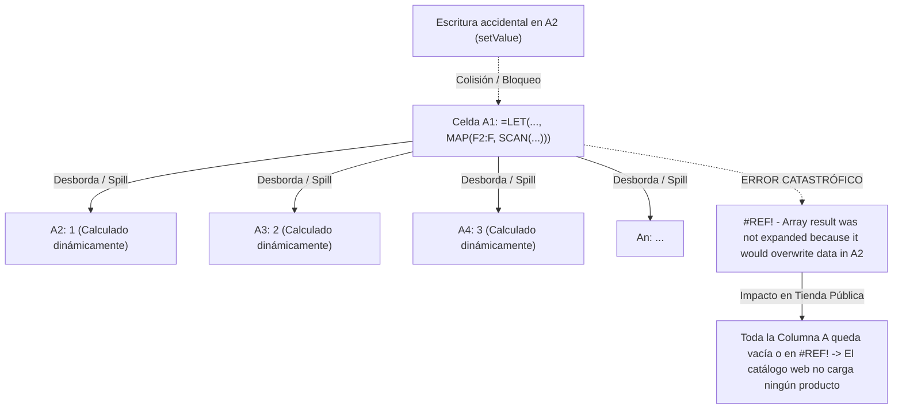
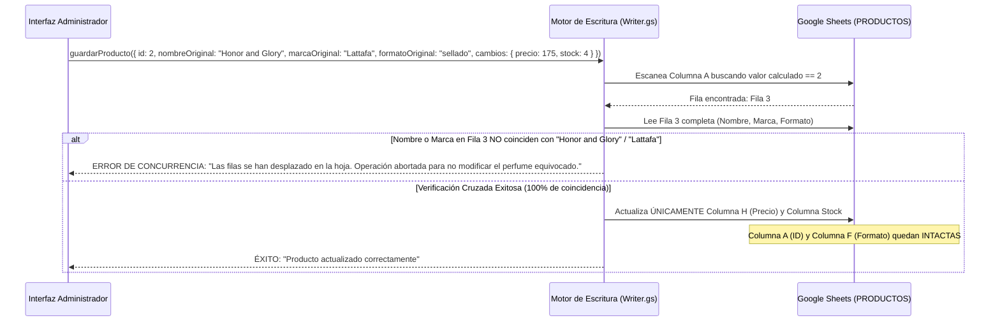

# DUNES PARFUMS ADMIN — FASE 2: PREPARACIÓN SEGURA
## Plan de Arquitectura Corregido, Seguridad, Fórmulas Matriciales y Escritura Controlada

**Proyecto:** Panel Administrativo Privado para *Dunes Parfums*  
**Autor:** Arquitecto de Software Senior  
**Estado:** Fase 2 — Preparación Segura (Plan Corregido tras Inspección Real de la Base de Datos)  
**Fecha:** Octubre 2026  
**Documento:** `PLAN-FASE-2-DUNES-ADMIN.md`

---

## 1. CONFIRMACIONES DEL ESQUEMA REAL EN GOOGLE SHEETS (HALLAZGO CRÍTICO)

La inspección visual directa sobre la copia de pruebas **`DUNES-PARFUMS-DATABASE-STAGING`** ha revelado información arquitectónica de máxima importancia que redefine por completo la estrategia de escritura y protección de datos:

| Hallazgo Confirmado | Estado Real en la Hoja | Impacto Crítico para el Administrador |
| :--- | :--- | :--- |
| **1. Fórmula en `PRODUCTOS!A1`** | Contiene una **fórmula matricial dinámica moderna** que utiliza `LET`, `SCAN` y `MAP`. | `A1` no es un simple texto de encabezado. Es el generador algorítmico de toda la columna de identificadores. |
| **2. Dependencia de Formato (Columna F)** | La fórmula de `A1` evalúa la **Columna F (`Formato`)** para asignar o secuenciar los IDs. | Modificar el valor de la columna F en una fila puede alterar el ID generado por la fórmula. |
| **3. Identificadores en `A2:A`** | `PRODUCTOS!A2` muestra el identificador numérico **`1`** (no `p1`). Los IDs visibles son numéricos. | El catálogo ya procesa strings numéricos (`"1"`, `"2"`, `"3"`), pero no son claves estáticas independientes de la hoja. |
| **4. Precio en Columna H** | `PRODUCTOS!H2` contiene el precio numérico **`169`**. | La columna H es el precio real en la hoja viva (en el CSV de respaldo se observaba en G; aquí está en H). |
| **5. Disponibilidad en Columna N** | La **Columna N** corresponde al estado de disponibilidad (`TRUE`/`FALSE`). | La columna N controla si el perfume se puede agregar al carrito en la tienda pública. |
| **6. Naturaleza del Rango Desbordado (*Spill Range*)** | En las celdas `A2, A3, A4...`, la función de Apps Script `celda.getFormula()` devuelve **vacío (`""`)**. | **Peligro fatal:** Si un script asume que celda sin fórmula es editable y escribe en `A2`, Google Sheets produce un error `#REF!` que destruye toda la columna A. |

---

## 2. FUNCIONAMIENTO DE LA FÓRMULA MATRICIAL EN A1 Y SUS RIESGOS

### 2.1 Cómo Opera una Fórmula Matricial con `LET`, `MAP` y `SCAN`
En las versiones modernas de Google Sheets, la combinación de estas funciones permite crear columnas completas calculadas desde una única celda raíz:
* **`LET`:** Declara variables y rangos dentro de la fórmula.
* **`MAP(F2:F, ...)`:** Recorre verticalmente la columna F fila por fila.
* **`SCAN(0, F2:F, LAMBDA(...))`:** Acumula un contador secuencial (1, 2, 3...) evaluando las filas de formato (por ejemplo, incrementando el contador si la fila tiene formato o ignorando filas vacías al final de la hoja).
* **Desbordamiento (*Spill*):** La fórmula reside físicamente **únicamente en `A1`**, pero proyecta sus resultados dinámicamente hacia abajo en el rango `A2:A`.



### 2.2 La Trampa de `getFormula()` en Rangos Desbordados
En la API interna de Google Sheets (`SpreadsheetApp`):
* `sheet.getRange("A1").getFormula()` devuelve el texto completo de la fórmula `LET(...)`.
* `sheet.getRange("A2").getFormula()` devuelve **`""` (cadena vacía)**, porque la celda A2 no almacena una fórmula propia, sino el valor proyectado por A1.
* **Regla de oro de arquitectura:**  
  **Nunca se debe validar la editabilidad de una celda únicamente con `celda.getFormula()`. La Columna A debe estar completamente bloqueada mediante una Lista Negra fija de escritura en el código.**

### 2.3 Vulnerabilidad de Reordenamiento de Filas
Dado que `SCAN` genera números secuenciales acumulativos según la posición física de las filas:
* **Si se reordena manualmente la hoja:** (por ejemplo, ordenando por Nombre de la A a la Z o por Precio), la fila que antes era la #2 (ID 1) pasará a ser, digamos, la #15, y se le asignará el ID 14. Mientras tanto, el producto que quedó en la fila #2 ahora tendrá el ID 1.
* **Impacto en los Clientes:** Los usuarios que tenían guardado en su navegador (`localStorage`) un producto en el carrito (`dunes_carrito`) con ID `"1"` ahora tendrían en su carrito un perfume completamente diferente.
* **Conclusión:** **Los IDs generados matricialmente NO son claves primarias inmutables independientes; son identificadores derivados de la posición.**

---

## 3. INTERPRETACIÓN DE LOS IDENTIFICADORES EN EL CÓDIGO DEL CATÁLOGO

Se realizó una auditoría en los archivos del catálogo web para verificar si la aplicación exige prefijos (`p` o `d`) o si tolera identificadores numéricos puros:

1. **[`js/productos-service.js:L298`](file:///c:/xampp/htdocs/DUNES-PARFUMS-CATALOGO/js/productos-service.js#L298):**
   ```javascript
   const idStr = rawObj.id ? String(rawObj.id).trim() : "";
   ```
   El parser normaliza cualquier valor que venga en la columna `id` a string mediante `String(rawObj.id).trim()`. No realiza ninguna aserción regex que obligue a empezar con `p` o `d`.
2. **[`js/productos.js:L75`](file:///c:/xampp/htdocs/DUNES-PARFUMS-CATALOGO/js/productos.js#L75):**
   ```javascript
   return todos.find(p => String(p.id) === String(id)) || null;
   ```
3. **[`js/interfaz.js:L761`](file:///c:/xampp/htdocs/DUNES-PARFUMS-CATALOGO/js/interfaz.js#L761):**
   ```javascript
   const prod = productos.find(item => item && String(item.id).trim() === idSolicitado);
   ```

**Conclusión Comprobada:**  
El catálogo público de Dunes Parfums **acepta e interpreta perfectamente identificadores numéricos** (`"1"`, `"2"`, `"3"`, etc.). Las pruebas previas que contenían `p1` o `d1` correspondían a datos estáticos de respaldo histórico, pero la tienda viva funciona con los identificadores que la fórmula matricial emita en el CSV publicado.

---

## 4. ESTRATEGIA PARA LOCALIZAR Y ACTUALIZAR PRODUCTOS EXISTENTES (CLAVE COMPUESTA DE VERIFICACIÓN)

Para resolver el riesgo de que las filas se muevan o se desincronicen, el motor del administrador no confiará ciegamente en el número de fila ni en el ID aislado. Se implementa una **Técnica de Verificación Cruzada Compuesta (Triple Check)**:



### Reglas de Localización Segura:
1. **Paso 1 (Búsqueda):** Buscar en la columna A la fila cuyo valor numérico coincida con el ID del producto que se está editando.
2. **Paso 2 (Validación de Identidad Cruzada):** Antes de tocar una sola celda, comparar el `Nombre` y la `Marca` de esa fila con los valores con los que se abrió el formulario.
3. **Paso 3 (Aborto Preventivo):** Si el nombre en esa fila no coincide (porque alguien insertó una fila arriba o reordenó la hoja en Sheets), el guardado se cancela de inmediato, protegiendo los datos.
4. **Paso 4 (Inmutabilidad de Formato):** Si un producto es `sellado`, no se permite cambiar su columna F a `decant` desde una edición rápida, ya que alteraría la secuencia del `SCAN` matricial en A1.

---

## 5. ESTRATEGIA SEGURA PARA AGREGAR PRODUCTOS (PREVENCIÓN DE CORRUPCIÓN EN SCAN)

Si la fórmula de `A1` utiliza `SCAN` acumulativo sobre la columna F:
* **REGLA ABSOLUTA:** **JAMÁS INSERTAR FILAS EN POSICIONES INTERMEDIAS.**  
  Si se insertara una fila en la posición 5, todos los productos de la fila 6 en adelante cambiarían de ID instantáneamente, corrompiendo los enlaces compartidos y carritos existentes.
* **MÉTODO DE CREACIÓN AUTORIZADO (APPEND AL FINAL):**
  1. Se localiza la **última fila con datos reales** en la hoja (`sheet.getLastRow()`).
  2. El nuevo producto se escribe **estrictamente en la fila `getLastRow() + 1`**.
  3. Se escriben los datos en las columnas permitidas (Nombre, Marca, Categoría, Formato en Columna F, Precios, etc.).
  4. **La celda de la columna A se deja totalmente vacía.**
  5. Automáticamente, la fórmula matricial de `A1` detectará la nueva entrada en la columna F y le asignará el siguiente número correlativo (`N + 1`).
  6. Ningún ID anterior sufre modificaciones.

---

## 6. MAPEO REAL DE COLUMNAS CONFIRMADAS Y LISTA NEGRA DE ESCRITURA

Con las confirmaciones obtenidas de la copia de pruebas, se establece el mapa de columnas y sus permisos de acceso en el código:

| Letra | Columna | Rol en el Sistema | Permiso en el Administrador |
| :---: | :--- | :--- | :---: |
| **A** | `id` | **Generado por Fórmula Matricial en A1** | 🚫 **LISTA NEGRA (SOLO LECTURA ABSOLUTA)** |
| **B** | `nombre` | Nombre comercial de la fragancia | ✅ Editable |
| **C** | `marca` | Casa perfumista (Lattafa, Armaf, etc.) | ✅ Editable |
| **D** | `categoria` | `arabe`, `nicho`, `disenador`, etc. | ✅ Editable |
| **E** | *Campo intermedio* | Género / Presentación | ✅ Editable con validación |
| **F** | `formato` | `sellado` / `decant` (**Insumo de A1**) | ⚠️ **PROTEGIDO (Solo editable al crear)** |
| **G** | *Campo intermedio* | Presentación o subprecio | ✅ Editable |
| **H** | `precio` | **Precio regular** (Confirmado: H2 = 169) | ✅ Editable (Número > 0) |
| ... | *Decants / Stock* | `precio_3ml`, `precio_5ml`, `stock`, etc. | ✅ Editable según formato |
| **N** | `disponible` | **Disponibilidad** (Confirmado) | ✅ Editable (Switch `TRUE`/`FALSE`) |

### Lista Negra de Escritura en Apps Script:
El motor de escritura `05_Writer.gs` incluirá una guarda dura a nivel de código:
```javascript
// 05_Writer.gs - Bloqueo de Columnas Protegidas
const COLUMNAS_PROHIBIDAS_ESCRITURA = [1]; // Columna A (ID matricial) NUNCA se toca

function escribirCeldaSegura(sheet, fila, colIndex, valor) {
  if (COLUMNAS_PROHIBIDAS_ESCRITURA.includes(colIndex)) {
    throw new Error(`VIOLACIÓN DE SEGURIDAD: Intento de escritura en columna protegida ${colIndex}`);
  }
  const celda = sheet.getRange(fila, colIndex);
  if (celda.getFormula() !== '') {
    throw new Error(`VIOLACIÓN DE SEGURIDAD: Celda ${celda.getA1Notation()} contiene fórmula`);
  }
  celda.setValue(valor);
}
```

---

## 7. IDENTIFICACIÓN DE OTROS POSIBLES RANGOS MATRICIALES PROTEGIDOS

Antes de habilitar cualquier función de escritura, el sistema debe inspeccionar si existen otras fórmulas matriciales en la **Fila 1**:
* **Riesgo:** Si alguna otra celda de la fila 1 (por ejemplo `M1`, `N1` o `H1`) contiene una fórmula de tipo `ARRAYFORMULA`, `MAP` o `SCAN` que genere los valores de disponibilidad o precios de toda la columna hacia abajo.
* **Mecanismo de Detección Automática:**
  El módulo `03_Reader.gs` incorporará una función de autodiagnóstico:
  ```javascript
  function detectarColumnasMatriciales(sheet) {
    const numCols = sheet.getLastColumn();
    const formulasFila1 = sheet.getRange(1, 1, 1, numCols).getFormulas()[0];
    const columnasMatriciales = [];
    formulasFila1.forEach((f, idx) => {
      if (f && f.trim().startsWith('=')) {
        columnasMatriciales.push({ columna: idx + 1, formula: f });
      }
    });
    return columnasMatriciales; // Si detecta fórmulas en A1, bloquea col 1 automáticamente
  }
  ```

---

## 8. DISEÑO DEL ENTORNO DE PRUEBAS (SANDBOX / STAGING)

Se utilizará la copia manual ya creada por el propietario: **`DUNES-PARFUMS-DATABASE-STAGING`**.

```javascript
// 01_Config.gs - Configuración Segura de Entorno
const APP_ENV = {
  CURRENT_MODE: 'STAGING', // BLOQUEADO EN STAGING HASTA AUTORIZACIÓN

  SPREADSHEETS: {
    STAGING: 'ID_DE_LA_COPIA_DE_PRUEBAS_STAGING',
    PRODUCTION: 'BLOQUEADO' // Ninguna función apunta a producción
  },

  PERMITIR_ESCRITURA: false // En el Hito 1: Modo SOLO LECTURA
};
```

* Durante el desarrollo del **Hito 1**, `PERMITIR_ESCRITURA` estará fijado en `false`. El sistema se limitará a leer, mapear y mostrar los productos en pantalla.

---

## 9. SEGURIDAD Y CONTROL DE ACCESO DEFINITIVO

* **Modo de Despliegue:** **`Execute as: Me` (Propietario)** y **`Who has access: Only myself` (Solo yo)**.
* **Garantía:**  
  * Google exige inicio de sesión con la cuenta de Google del propietario.
  * Si un tercero obtiene la URL del administrador, Google le muestra un error `403 Prohibido`.
  * La aplicación aprovecha el inicio de sesión ya activo y el 2FA biométrico en el celular del propietario sin requerir contraseñas adicionales.
  * Cero superficie de ataque en internet.

---

## 10. VERIFICACIONES OBLIGATORIAS ANTES DE HABILITAR ESCRITURA

Antes de que se permita ejecutar una sola operación de escritura (`setValue`), se deben cumplir los siguientes requisitos:

1. **Documentar la fórmula completa de `PRODUCTOS!A1`:** Copiar el texto íntegro de la fórmula de `A1` para entender todas sus variables y condiciones.
2. **Inspeccionar Fila 1 de `PRODUCTOS`:** Confirmar si alguna otra celda entre `B1` y `T1` tiene fórmulas que empiecen con `=`.
3. **Inspeccionar Fila 2 de `PRODUCTOS`:** Confirmar si `H2` (precio 169) o `N2` (disponible) contienen fórmulas o son valores literales planos.
4. **Prueba de Creación al Final:** Verificar en la copia de pruebas que escribir en la fila vacía al final genere automáticamente el ID sin errores `#REF!`.

---

## 11. CONCLUSIÓN Y DICTAMEN ARQUITECTÓNICO

### ¿Es seguro comenzar la programación del administrador en modo SOLO LECTURA?

> ### ✅ DICTAMEN: SÍ, ES 100% SEGURO COMENZAR EN MODO SOLO LECTURA.
>
> **Justificación Técnica:**
> 1. El desarrollo del **Hito 1 (Lectura y Visualización)** únicamente utiliza métodos pasivos de lectura (`getValues()`, `getDataRange()`).
> 2. Se ejecutará **exclusivamente sobre la copia de pruebas `DUNES-PARFUMS-DATABASE-STAGING`**, sin tocar la base original de producción ni el catálogo web público.
> 3. No se ejecutará ninguna llamada a `setValue()`, `appendRow()` ni `insertRow()`.
> 4. La celda `A1` y su fórmula matricial no corren ningún riesgo de colisión ni desbordamiento en operaciones de lectura.
> 5. Permitirá verificar en tiempo real, desde tu computadora y tu celular, que la interfaz visual de Dunes Admin lea correctamente los nombres, marcas, precios (H), disponibilidad (N) y los identificadores matriciales de la Columna A.

---

> [!IMPORTANT]
> **ESTADO DEL PROYECTO:**  
> Ningún archivo del catálogo público existente, ninguna hoja de cálculo y ninguna fórmula ha sido alterada. El entorno está protegido y listo para iniciar la programación del **Hito 1 (Solo Lectura en Staging)** una vez recibida tu autorización.
